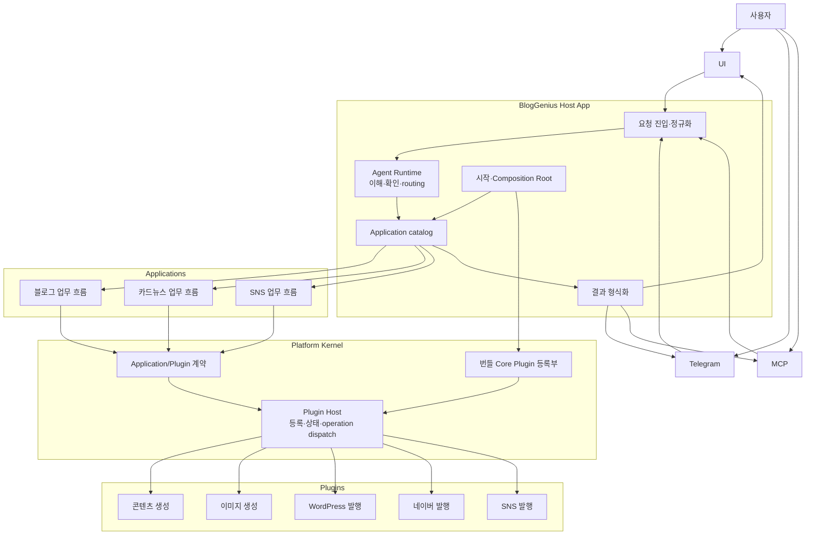

# BlogGenius를 기능 모음에서 플랫폼으로: Host, Kernel, Application, Plugin 이해하기

BlogGenius를 만들며 처음에는 네이버 블로그에 글을 올리고, 워드프레스에 발행하고, 카드뉴스를 만들고, SNS에 공유하는 기능을 하나씩 더했습니다. 기능이 늘어날수록 질문도 생깁니다.

> 새 기능이 추가될 때마다 기존 앱 안에 코드를 더하는 게 맞을까? 아니면 기능을 독립적인 모듈로 만들고, 필요한 흐름에서 조립해 쓰는 게 나을까?

이 질문을 따라가다 보니 BlogGenius를 단순히 기능이 많은 앱이 아니라 **여러 기능을 연결해 사용자의 일을 완수하는 플랫폼**으로 바라보게 됐습니다. 이 글에서는 그 구조를 이루는 용어와 각자의 역할, 요청이 처리되는 흐름, 현재 코드와 목표 구조의 차이를 정리합니다.

<!-- 스크린샷 제안: BlogGenius 기능 흐름을 간단한 블록으로 보여주는 그림 -->

## 먼저 비유로 보기: 공항, 업무 흐름, 도구

구조를 이해하기 위해 공항에 비유해 보겠습니다.

- **Host App**은 공항 운영 시스템입니다. 요청을 받고, 어디로 안내할지 결정하며, 전체 시스템을 시작하고 구성합니다.
- **Application**은 여행 여정입니다. 체크인, 탑승 수속, 환승처럼 여러 단계를 순서대로 묶어 목적을 달성합니다.
- **Plugin**은 항공사나 수하물 처리처럼 구체적인 일을 수행하는 서비스입니다.
- **Platform Kernel**은 공항의 공통 규칙과 연결 기반입니다. 각 서비스가 같은 방식으로 등록되고 호출되도록 합니다.
- **Channel Adapter**는 공항 안내 데스크나 모바일 앱처럼 사용자가 요청하고 결과를 받는 창구입니다.

비유에서 중요한 점은 공항 운영 시스템이 비행기를 직접 운항하지 않는다는 것입니다. Host는 기능을 직접 다 구현하기보다, 어떤 업무 흐름이 적합한지 고르고 그 흐름이 필요한 도구를 쓰도록 연결합니다.

## 용어를 하나씩 정리해보기

### Host App: BlogGenius를 실행하고 연결하는 제품 런타임

Host App은 BlogGenius라는 제품 전체의 실행 환경입니다. 앱을 시작하고, UI·Telegram·MCP 같은 여러 경로에서 요청을 받아 공통 형식으로 정리하며, Agent Runtime과 Application을 구성하고 연결합니다.

Host는 **“어떤 사용자 요청을 어떤 업무 흐름에 맡길까?”**를 다룹니다. 글 작성이나 워드프레스 API 호출 같은 구체 작업을 직접 소유하는 영역은 아닙니다.

### Platform Kernel: Plugin이 공통 규칙으로 연결되는 기반

Kernel은 Plugin을 등록하고, 어떤 작업을 제공하는지 확인하고, 실제 실행을 중개하는 공통 기반입니다. Plugin의 입력과 결과를 계약에 맞게 검사하고, 비활성화된 Plugin의 새 실행을 막는 lifecycle도 관리합니다.

Kernel이 블로그 작성 순서나 카드뉴스의 구성 규칙까지 알기 시작하면 도메인별 흐름이 모두 Kernel로 모여 덩치가 커집니다. 그래서 Kernel은 작고 안정적인 연결 규칙에 집중해야 합니다.

### Plugin Host와 Host App은 다른 것

둘 다 Host라고 부르지만 담당 범위가 다릅니다.

| 이름 | 담당하는 일 | 예시 |
| --- | --- | --- |
| **BlogGenius Host App** | 앱을 시작하고 채널 요청을 받아 Application을 선택·구성 | 사용자의 요청을 블로그 작성 흐름으로 전달 |
| **Plugin Host** | Kernel 안에서 Plugin 등록, operation 조회, 활성 상태, 실행을 관리 | `wordpress-publisher`의 `posts.create` 실행 |

즉, Plugin Host는 UI를 띄우거나 사용자의 문장을 해석하지 않습니다. 반대로 Host App은 모든 Plugin의 HTTP 요청 구현을 직접 알 필요가 없습니다.

또한 여기서 BlogGenius Host App이라고 부르는 것은 BlogGenius 자체의 설계 용어입니다. MCP 문맥의 **MCP Host**와 이름이 비슷해도 동일한 개념이라고 가정하면 안 됩니다. MCP를 연결하면 MCP Host는 보통 Codex나 Claude Desktop처럼 MCP Client를 관리하는 외부 프로그램을 가리킵니다.

### Application: 사용자의 목적을 이루는 업무 흐름

Application은 여러 operation을 순서와 조건에 따라 조합해 하나의 사용자 목적을 달성합니다.

예를 들어 블로그 발행 Application은 원고와 이미지를 준비하고, 카테고리를 확인하고, 발행 결과에 따라 성공이나 초안 저장 상태를 정리할 수 있습니다. SNS Application은 게시할 콘텐츠를 다듬고 선택한 채널에 전달한 뒤 결과를 모을 수 있습니다.

Application은 **“무엇을 어떤 순서로 할까?”**를 소유합니다. 특정 워드프레스 라이브러리나 API 호출을 직접 구현하는 대신, 필요한 Plugin operation을 Kernel의 실행 계약으로 요청합니다.

### Plugin과 operation: 실제 능력을 제공하는 모듈

Plugin은 경계가 분명한 기능을 제공합니다. 예를 들면 다음과 같습니다.

- 콘텐츠 초안 생성
- 이미지 생성
- 워드프레스 글 발행
- 네이버 블로그 글 발행
- SNS 게시물 공유

각 Plugin은 하나 이상의 **operation**을 선언할 수 있습니다. 워드프레스 Plugin이라면 `media.upload`, `categories.list`, `posts.create` 같은 operation이 있을 수 있습니다. Application은 필요한 operation을 호출하고, Plugin은 제공자별 세부 통신을 맡습니다.

### Core Plugin과 Community Plugin: 구현 방식이 아니라 관리 주체

Plugin이라는 말은 기능을 모듈로 제공하는 **형태**를 설명합니다. Core Plugin과 Community Plugin은 누가 관리하고 어떻게 배포하는지를 설명합니다.

- **Core Plugin**은 BlogGenius 팀이 관리하고 앱에 함께 번들하는 공식 Plugin입니다. 런타임에 활성·비활성 상태를 관리할 수 있지만, 사용자가 개별 설치·삭제하는 것은 초기 범위가 아닙니다.
- **Community Plugin**은 외부 개발자가 별도 저장소와 버전으로 배포하는 확장입니다. 설치, 신뢰, 권한, 격리, 업데이트 규칙은 별도 설계가 필요합니다.

따라서 워드프레스 발행과 네이버 발행은 기능 종류가 아니라 각각 독립적인 Plugin 경계로 만들 수 있습니다. 콘텐츠 생성도 발행과 별개의 Plugin이 될 수 있고, 이를 어떤 Application 흐름에서 함께 사용할지는 Application이 결정합니다.

### Channel Adapter: 같은 기능을 여러 창구에서 쓰게 하는 연결부

UI, Telegram, MCP는 사용자가 BlogGenius에 요청하는 서로 다른 창구입니다. 각 창구는 입력과 출력 형식이 다릅니다. Channel Adapter는 그 차이를 변환하지만, 블로그 발행 절차 같은 업무 규칙을 각자 따로 구현하지 않습니다.

같은 Application을 UI에서 버튼으로 시작하든 Telegram에서 자연어로 요청하든, 업무 흐름을 공유하는 것이 목표입니다. 이 원칙이 지켜져야 채널이 늘어나도 기능의 동작이 제각각으로 갈라지지 않습니다.

### Agent Runtime: 요청을 이해하고 알맞은 Application을 고르는 역할

Agent Runtime은 사용자의 자연어 요청을 이해하고, 어떤 Application이 적합한지 판단합니다. 정보가 부족하거나 발행 대상이 불분명하면 임의로 최종 동작을 추측하기보다 사용자에게 묻습니다.

Agent가 알고 있는 기능을 상상해서 호출해서는 안 됩니다. 실제로 등록되어 있고 활성 상태이며 필요한 조건을 만족하는 operation을 기준으로 선택해야 합니다. 이런 실행 가능 목록은 Plugin Host가 제공하는 런타임 정보와 연결됩니다.

### Skill: 기능 구현이 아니라 AI가 읽는 사용 안내

Skill은 AI가 기능을 언제, 어떤 순서로, 어떤 제한과 함께 써야 하는지 설명하는 지침입니다. 실제 실행 코드는 Plugin에 있고, 허용된 operation은 Host가 관리합니다.

간단히 구분하면 **Plugin은 실행 능력**, **Skill은 그 능력을 잘 선택하고 사용하는 방법에 대한 설명**입니다. Skill 파일이 있다고 새로운 기능이 자동으로 생기는 것은 아닙니다.

## 요청은 어떤 경로로 움직일까?

사용자가 “제주 산책에 관한 글을 워드프레스에 발행해줘”라고 요청했다고 가정해 보겠습니다.

```text
사용자
  ↓
UI / Telegram / MCP
  ↓
Host App의 요청 진입점
  ↓
Agent Runtime: 요청 이해, 빠진 정보 확인, Application 선택
  ↓
블로그 발행 Application: 작업 순서 구성
  ↓
Kernel의 Plugin Host: 등록·상태 확인, operation 검증·호출
  ↓
콘텐츠 생성 Plugin → 이미지 Plugin → WordPress Publisher Plugin
  ↓
Application이 결과 정리
  ↓
Host App이 원래 요청 채널에 맞게 결과 표시
```

발행할 블로그가 정해져 있지 않거나 원고가 없는 상황이라면 흐름은 바로 발행으로 가지 않을 수 있습니다. Agent Runtime은 필요한 내용을 물어보거나 사용자가 선택할 수 있도록 요청을 보완합니다. 사용자가 “글감으로만 저장해줘”라고 했다면 발행 Application 대신 그 목적에 맞는 흐름을 선택해야 합니다.

Application은 Plugin 여러 개를 조합할 수 있지만, 모든 요청이 모든 Plugin을 거치는 것은 아닙니다. 글감 저장에는 발행 Plugin이 필요 없고, 이미지를 사용하지 않는 글에는 이미지 생성 Plugin이 호출되지 않을 수 있습니다.

## 전체 목표 구조를 한눈에 보기



이 그림은 BlogGenius가 향하는 구조입니다. 모든 상자가 현재 코드에 이미 구현되어 있다는 뜻은 아닙니다.

## 현재 코드와 목표 구조는 어디까지 왔을까?

현재 제품 요청은 기존 흐름으로 처리됩니다.

```text
현재 제품 경로
UI / Telegram / MCP
  → 기존 Agent Runtime
  → 기존 Capability Registry와 실행 계층
  → 채널별 결과 응답
```

새 Kernel과 Application 구조는 기존 운영 경로 옆에서 검증 중입니다. 현재 저장소에는 Kernel의 Plugin 계약과 Plugin Host, 예제 Application, WordPress 발행 Plugin pilot, 이를 조립하는 composition 코드가 있습니다. 하지만 WordPress pilot이 일반 UI·Telegram·MCP 요청을 받아 실제 사용자 발행 흐름으로 연결된 것은 아닙니다.

현재 주요 경로와 목표 경로를 나란히 보면 이렇습니다.

| 책임 | 현재 코드 경로 | 목표 경로 |
| --- | --- | --- |
| Web UI | `ui/`, `src/ui-runtime/`, `src/ui-api/` | `src/adapters/ui/` 경계로 정리 |
| Telegram | `src/telegram-*.js`, `src/channels/telegram/` | `src/adapters/telegram/` |
| MCP | `src/mcp/` | `src/adapters/mcp/` |
| Agent와 기능 선택 | `src/agent/`, `src/capabilities/` | Host App의 Agent Runtime과 Application 선택 |
| 기존 capability Plugin 관리 | `src/plugins/` | Kernel Plugin Host로 단계적 전환 검증 |
| 신규 Plugin 실행 기반 | `src/platform/plugin-host.js` | Platform Kernel의 안정된 공통 계약 |
| 신규 업무 흐름 | `src/applications/` | 같은 경계에서 제품별 Application 확장 |
| Plugin 조립 | `src/composition/` | Host 시작 시 catalog와 Application 구성 |
| 독립 Plugin 패키지 | `packages/plugins/core/wordpress-publisher/` | 독립 사용 계약을 갖춘 Core/Community 패키지 |

특히 `src/plugins/`와 `src/platform/plugin-host.js`를 같은 것으로 보면 안 됩니다. 전자는 현재 제품의 capability 기여를 관리하는 기존 host이고, 후자는 새 Plugin operation 계약을 검증하는 Kernel 기반입니다. 둘이 나란히 존재하는 것은 아직 전환 중이기 때문입니다.

목표안의 `src/host/`와 `src/adapters/`는 아직 만들어지지 않았습니다. 구조가 먼저 정해졌다고 빈 디렉터리를 만들거나 기존 파일을 이름만 바꿔 옮기지는 않습니다. 실제 요청 하나를 새 Application으로 연결할 때 필요한 계약과 테스트를 함께 만들며 경계를 구체화하는 것이 원칙입니다.

## 왜 처음부터 전부 다시 만들지 않을까?

기존 코드를 무조건 보존하면 새로운 경계가 과거 구조에 끌려갈 수 있습니다. 반대로 한 번에 전체를 갈아엎으면 아직 검증하지 않은 설계를 제품 전체에 적용하게 됩니다.

그래서 BlogGenius는 **새 구조를 현재 저장소 안에 만들고, 작은 단위로 실행·검증하며, 업무 흐름을 하나씩 새 구조로 옮기는 방식**을 택했습니다. 구조 검증 단계에서 기존 함수와의 호환성을 목표로 삼지는 않습니다. 다만 사용자가 보관한 데이터나 외부 서비스에 이미 일어난 발행·결제 같은 부작용은 코드 교체와 별도로 신중히 다뤄야 합니다.

이 방식은 과거 코드를 기준으로 새 구조를 타협하지 않으면서도, 검증되지 않은 플랫폼을 한꺼번에 제품에 얹지 않도록 합니다.

## 정리: 플랫폼은 기능보다 연결 규칙을 먼저 세웁니다

BlogGenius가 플랫폼으로 발전하려면 새 기능을 추가하는 것만큼 각 경계가 무엇을 책임지는지 분명해야 합니다.

- **Host App**은 요청과 실행 환경을 관리합니다.
- **Agent Runtime**은 요청을 이해하고 적절한 Application을 선택하거나 부족한 정보를 확인합니다.
- **Application**은 사용자의 목적을 업무 흐름으로 구성합니다.
- **Platform Kernel의 Plugin Host**는 등록된 Plugin operation을 공통 규칙으로 실행합니다.
- **Plugin**은 구체적인 생성·발행 능력을 제공합니다.
- **Channel Adapter**는 UI, Telegram, MCP를 공통 요청 흐름에 연결합니다.
- **Skill**은 AI가 Plugin 능력을 잘 사용하는 방법을 설명합니다.

이 구조가 자리 잡으면 새 채널이나 새 발행 서비스를 추가할 때 기존 모든 기능을 다시 짜는 대신, 정해진 계약을 구현하고 적절한 Application에 조합할 수 있습니다. 아직은 그 목표를 향한 기반을 만드는 단계입니다. 다음 기능을 추가할 때도 먼저 “이 코드는 어느 경계의 책임인가?”를 묻는 것이 플랫폼을 탄탄하게 만드는 출발점입니다.
