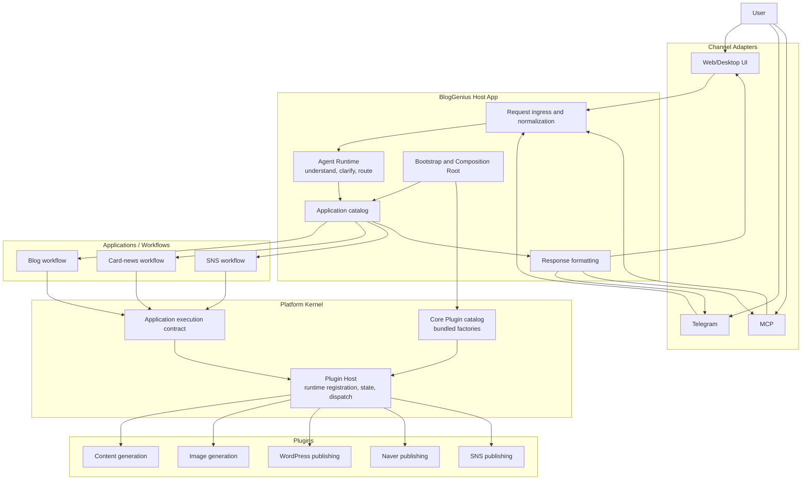

# Platform Kernel, Applications, and Plugins

## Purpose and status

BlogGenius is establishing a platform boundary that lets independently owned capabilities be composed into product use cases without placing every business workflow in the Core. This document defines the target direction, the first executable foundation slice, and provider Plugin pilots. Blog Beta's AI manuscript generation and WordPress manuscript publication exercise these boundaries; Card News text and image generation now also uses the shared AI Generation service while retaining its existing Card News workflow and persistence service. Most other product paths remain on their existing runtime.

The migration strategy is to establish the new boundaries in this repository and prove them with code and tests. Existing implementation is optional reference material, not a compatibility contract or a constraint on the new structure. Functions and paths may be replaced or removed when the new architecture is ready; separately owned user data and external side effects still require deliberate handling.

## Layers

### Platform Kernel

The Kernel owns the stable host-side contracts and execution boundary:

- Plugin registration and operation discovery.
- Descriptor and operation input/output contract validation.
- Dispatch to a declared operation.
- Plugin enable/disable lifecycle, including rejecting new calls while disabled and draining tracked calls during disable.
- Shared execution policy, confirmation, and context boundaries as those contracts are introduced.

The Kernel does not own content generation, publishing, or product-specific sequencing. It must remain smaller than the set of Applications it hosts.

Initial implementation: `src/platform/`. `src/plugins/` is the legacy/current Core Plugin capability host and is not yet replaced by this foundation.

### Applications

An Application owns a product use case and composes operations into a business flow. Blog publishing, card-news creation, and social sharing are candidate Applications. Generation and publishing are functional categories or stages that an Application may compose; they are not separate architecture layers.

Applications depend on domain/service ports and do not import concrete Plugin implementations or invoke the Plugin Host. Shared services express reusable contracts; Plugin adapters translate those contracts into Host operation calls, and composition injects them. Blog Beta's manuscript writing and WordPress publishing flows use these boundaries; other product areas remain candidates for gradual migration.

### Plugins

A Plugin provides one or more bounded operations, for example text generation, image generation, WordPress publishing, or Naver publishing. “Plugin” describes the implementation/package form. “Core Plugin” and “Community Plugin” describe ownership and distribution:

- Native Core Plugins are first-party operation packages bundled with BlogGenius. The host can enable/disable them at runtime; this does not imply exposing a toggle for every plugin. They are not individually installed or removed by users. Static Widget Plugins have their separate package and installation contract below.
- Native Community Plugins with executable Host operations remain a later extension stage because their operation permissions, trust, lifecycle, and isolation require additional design. Static Widget Plugins are a separate, narrower extension contract described below: they package their own UI and behavior, are discovered from the user-data plugin directory at startup, and run with no Host API or network access in sandboxed iframes.

Plugin packages own the complete implementation of their declared capability. They may use documented Host contracts for generic facilities such as credentials, transport, or lifecycle, but must not delegate core behavior back to BlogGenius-private Application or legacy code. A wrapper around an app-owned implementation is not a completed Plugin migration. “Independently distributable” means packageable and loadable through the documented Plugin Host contract; it does not promise a stable external SDK or compatibility guarantee.

### Agent Runtime and Channels

UI, Telegram, and MCP are channel adapters. They accept requests and use the shared Agent Runtime; they must not implement product workflows independently. The Agent Runtime interprets requests, selects an Application or asks the user for missing information, and consults the runtime capability/operation registry as the source of truth. The current Agent Runtime and channel implementations have not yet been moved onto this foundation.

## End-to-end architecture and request flow

“Host” refers to two related but different things. **BlogGenius Host App** is the product runtime that starts the system, accepts channel requests, chooses an Application, and owns composition. **Plugin Host** is a Kernel component that registers Plugin descriptors, exposes available operations, enforces enabled state, validates calls, and dispatches operations. The Plugin Host does not render UI or decide which product workflow a user means.

Target request and result flow:



In a successful flow, a channel adapter normalizes input, the Agent Runtime identifies the intent and asks for missing decisions when needed, and the Host App selects an Application. The Application owns the business sequence and requests operations through the Kernel contract. The Plugin Host checks registration and lifecycle state, validates and dispatches each operation, and returns results to the Application. The Host App formats the result for the originating channel. A request may stop for clarification or confirmation instead of invoking a Plugin.

The diagram is the agreed target, not a claim that every box or arrow is implemented. Blog Beta's direct manuscript publication path now invokes the WordPress Publishing Application through the Plugin Host. Other UI, Telegram, and MCP paths have not been routed through a shared Host App ingress. The current Agent/Capability path and the new Plugin Host remain parallel systems.

Most operational product traffic still follows the existing control path:

```text
Existing UI / Telegram / MCP ingress -> Agent Runtime -> Capability Registry -> Execution Layer
                                                       -> Memory and channel-specific response
```

The new Kernel/Application path is used by Blog Beta's direct AI manuscript generation and WordPress manuscript publication. Other Applications remain examples or pilots. For current Agent Runtime, capability, and memory ownership, see [`architecture/overview.md`](overview.md), [`architecture/agent-runtime.md`](agent-runtime.md), and [`architecture/memory-graph.md`](memory-graph.md).

## Directory ownership: required target and gradual migration

The repository uses these top-level boundaries for new code. Keep business applications grouped by product area, and put reusable technical helpers under `utilities/` with a capability-specific subdirectory. The tree shows stable ownership boundaries; internal files should be split only when a real contract or code size calls for it.

### Product verticals and menu workflows

A product/menu vertical is an Application grouping, not an architecture layer. Keep the vertical's use cases and their coordination together under `src/applications/<name>/`, even when its browser UI, HTTP routes, provider protocols, or persistence live in other layers. For example, Blog's quick writing, trend posting, comment drafting, and topic/queue workflows belong to the Blog Application; their markup and browser interaction remain in `ui/`, UI/API translation remains at the UI/API boundary, and Naver, Google Sheets, and other external protocols remain in adapters. Shared capabilities such as AI Generation, social publishing, memory, or reusable media operations stay in their cross-application service, Plugin, or utility boundary and are injected into the owning Application.

Do not mirror every tab with a new Application or move a tab's whole file tree into `applications/`. A tab is an entry point. Group Application code by actual use case/capability, and split modules only where ownership or a stable contract warrants it. The same convention applies to Shopping, Card News, SNS, Settings, and future product verticals: application-specific orchestration belongs under its corresponding `src/applications/<name>/`; presentation, transport, provider, and shared technical code stay in their respective layers.

Browser-side screen controllers remain in `ui/scripts/` even when they serve an Application vertical. Their directory roles and the legacy combined Blog/Shopping content workspace are defined in [UI Runtime Boundaries](ui-runtime-boundaries.md); do not place DOM-facing code in `src/applications/` just because it is named after a menu.

```text
src/
  host/                         # BlogGenius process/bootstrap and channel-to-Application routing
    launcher.js                 # Node-side UI launcher
    electron/                   # Electron startup, lifecycle, and recovery
    updater.js                  # Desktop update lifecycle and restart
  adapters/                     # Channel and external protocol translation (UI, Telegram, MCP, Plugin ports)
    url-shortening/              # URL shortener provider protocol adapters
    ui/                          # UI/API input, output, and progress presentation adapters
  platform/                     # Plugin contracts, Plugin Host, validation, lifecycle, dispatch
  composition/                  # Concrete Plugin/service wiring for runtime and Applications
  services/                     # Shared cross-Application capabilities/contracts
    url-shortening/              # Provider-neutral URL shortening behavior
  applications/                 # Product workflows, orchestration, and app-specific services/policy
    blog/                       # Blog writing and publication use cases
    card-news/                  # Card-news workflows
    sns/                        # SNS workflows
    <application-name>/         # Future product Applications follow the same grouping
  utilities/                    # Reusable technical behavior without product policy
    media/                      # Image/media transformation and format-level operations
    logging/                    # Shared logging and runtime log-path behavior
    browser/                    # Shared local Playwright launch mechanics
  ...                           # Legacy areas migrate only as their boundary is redesigned

packages/
  plugins/
    core/                       # Bundled native Plugin and static Widget Plugin packages
```

The SNS and Card News verticals use a shared capability-named `social-publisher` Plugin. Its provider implementation is currently Buffer and lives under `packages/plugins/core/social-publisher/providers/buffer/`; Applications depend on the `src/adapters/plugins/social-publisher.js` port and do not name the current provider in that boundary. SNS workflows live under `src/applications/sns/`, while shared publishing rules, feed utilities, and external storage/media adapters live in `src/services/`, `src/utilities/`, and `src/adapters/` according to ownership.

The Settings menu follows the same vertical rule without absorbing every setting implementation. Its shared Blog/Shopping writing-profile management, AI model selection, app-level listen/input preferences, basic connection configuration, optional-service preferences, and external-connection workflows live under `src/applications/settings/`; Card News source settings live with their owning workflow in `src/applications/card-news/source-settings/`, even though the controls are surfaced in Settings. Settings UI stays in `ui/`, while Settings HTTP routes, controller, and transitional service adapter live in `src/adapters/ui/settings/`. Config file access is supplied through a repository port. Reusable profile persistence and analysis remain in their existing content modules, Card News source rules stay in the Card News Application, AI model catalog and provider checks stay behind AI Gateway, and AI Generation is an injected capability. The read-only Core Plugin inventory endpoint is a generic UI adapter under `src/adapters/ui/plugins/`; the Settings screen consumes Platform-owned Plugin Runtime state without a separate Settings Application because it currently has no additional workflow policy. Settings Applications own menu workflows, not provider protocols or generic UI mechanics.

Knowledge and Memory are separate reusable domains and must remain distinct. `src/services/knowledge/` owns provider-neutral `kind + transport + config` contracts, normalized snapshot contracts, and registry/selection behavior. `src/adapters/knowledge/` owns provider-specific implementations, gateway clients, and transport protocols. Knowledge retrieval does not itself become user memory or recommendation policy. `src/services/memory/` owns event-first memory semantics, retrieval/context projections, provenance normalization, and owner/activity read models; it does not own SQLite or process lifecycle. `src/adapters/storage/memory/` owns Memory schema, event persistence, payload encoding, and SQLite lifecycle mechanics. `src/host/memory/` owns process startup/recovery, health gating, background maintenance scheduling, and shutdown. Recommendation lifecycle storage is separately owned by `src/adapters/storage/recommendations/`, with its policy and lifecycle contract under `src/services/recommendations/`. When Memory facts inform Recommendations, connect them through injected retrieval/service contracts; do not merge the domains or let Memory depend on Recommendation producers or policy.

Account overview assembly lives in `src/applications/account/overview/`: it combines injected license and connection results into account, subscription, usage, capability, device, and connection read models. The live Naver-session and WordPress-connection check orchestration is account-specific and lives in `src/applications/account/overview/connection-readiness.js`; provider checks and verification persistence are injected. `src/adapters/storage/connection-verifications/` stores credential-signature hashes and status metadata, never raw credentials. Shared signature identity and display-trust windows live in `src/services/connection-verification/`; these policies do not persist state or inspect live provider connectivity. The `/api/v1/account/overview` route and HTTP response/error translation live in `src/adapters/ui/account/`; common controller response mechanics live in `src/adapters/ui/controller-common.js`. `src/services/configuration-readiness/` owns a separate shared setup calculation based on whether AI, spreadsheet, and publishing settings are configured. It does not inspect live network/session connectivity, so it must not be merged with the Account connection-check workflow.

SNS automatic-distribution controls are surfaced in Settings but owned by `src/applications/sns/distribution/`: source selection, the current three-channel Application limit, enabled-state validation, safe reads, and config persistence belong to SNS distribution policy. Buffer authentication and publish operations remain in the Social Publisher Plugin. Other optional connection and notification preference workflows live under `src/applications/settings/optional-services/`; Telegram inbound and remote MCP enablement/configuration workflows live under `src/applications/settings/external-connections/`. The Settings service adapts UI requests and supplies config/runtime ports, while connection inspection, messaging, short-link transport, and process lifecycle stay in their provider adapters, Plugins, or Host.

Channel-selection counts are Application policies: SNS and Card News currently allow up to three selected channels. The Social Publisher Plugin contract must not encode that product limit. The Buffer provider issues one `createPost` operation per delivery and one post lookup per ID; Buffer's request quotas are provider limits and are handled as API responses, not as a fixed channel-count cap. Buffer plan allowances such as the number of connected channels are account constraints, not a batch-size limit for this Plugin.

The layer rules are mandatory for new code:

- `host/` starts the product runtime and routes normalized channel requests. It does not own business workflows or Plugin implementations.
- `host/network/` owns process-wide Node network startup policy, such as dual-stack address-family retry timing. Provider HTTP transport remains with its adapter or Plugin.
- `adapters/` translates channel or external-protocol input/output to internal contracts, including Plugin operation ports. AI provider endpoint/authentication/HTTP transport belongs to the AI Gateway Plugin; the Host adapter resolves credentials and short-lived profile references. Adapters do not own product workflows or model-selection policy.
- `adapters/ui/` is the UI/API boundary around Applications: it maps surface inputs to Application calls and maps results or structured progress into surface-specific presentation. UI/API adapters call Applications; Applications do not call UI adapters. Presentation text and response shapes stay out of Application policy. Screen rendering remains the responsibility of the UI runtime.
- `platform/` owns the shared Plugin contract, discovery/validation rules, registration and runtime lifecycle, operation validation, and dispatch. It does not choose a product workflow.
- `composition/` selects concrete Plugins and injects host-owned services/configuration into an Application runtime. Product decisions stay in Applications.
- `applications/<name>/` owns that product area's workflows and policies. For example, `applications/blog/` owns blog generation and publication coordination; target-specific image format policy belongs to publication, not the generic media utility or publisher Plugin.
- App-specific top-level services also belong under `applications/<name>/`, grouped by real workflow/capability (for example `generation/`, `publishing/`, or `services/` where a distinct internal boundary exists). `src/services/<domain>/` is reserved for reusable contracts/capabilities shared across Applications; it is not a generic home for every product's service layer.
- `services/licensing/` owns provider-neutral entitlement contracts and shared quota/smart-usage policy. Supabase RPC and Edge Function protocols belong in `adapters/licensing/`; license-key persistence remains in `adapters/storage/license-keys/`, device identity and credential resolution stay Host-owned, and `composition/` wires these dependencies. Applications and channel runtimes consume injected licensing ports and must not construct Supabase clients or import the provider adapter.
- `utilities/<capability>/` owns reusable technical operations. `utilities/media/` performs requested image conversion but does not decide whether WordPress should use AVIF or Naver should use WebP; `utilities/logging/` owns shared logging mechanics without product-specific policy; `utilities/browser/` owns local Playwright startup and launch-option normalization, not authentication or product workflows.
- `host/configuration/` owns process/runtime root resolution, packaged-default discovery, and loading the user configuration document during startup. Persisted license-key files belong to `adapters/storage/license-keys/`; runtime environment validation and secret injection remain under `environment/`. Product prompt/default assets live with their owning Application or shared content domain. The legacy `config-loader.js` remains a compatibility composition point while its flat product-policy projections are migrated; do not relocate it wholesale.
- `host/updater.js` owns desktop update checks, download/apply, recovery, and restart lifecycle. UI/API ingress can invoke its operations but does not own update behavior.
- `packages/plugins/core/` holds independent bundled Plugin implementations. Plugins follow manifest contracts and do not import BlogGenius-private Application modules.

Do not add new Application business logic to legacy top-level product directories such as `src/card-news/` or `src/blog-next/` merely because an older caller lives there. Their To-Be Application homes are `src/applications/card-news/` and `src/applications/blog/`, respectively. SNS workflows have already moved under `src/applications/sns/`; shared social publishing rules, feed utilities, and external adapters are placed in their owning layers. This is a responsibility-based target, not a wholesale directory rename: UI/channel entrypoints, external-system adapters, and genuinely shared services/utilities belong in their own layers. Migrate existing files in scoped, coordinated slices: trace callers, classify each file, move it to its owning layer, and update imports/tests/docs together. Preserve existing external contracts unless an intentional contract change is in scope. When connecting legacy callers to a new boundary, add a small adapter or composition seam in the target layer. Do not create empty placeholder directories. Community Plugin scanning, trust, permissions, distribution, and isolation are future design work; the directory name above reserves no runtime contract.

Current implementation follows the target in these slices:

```text
src/
  platform/plugin-contract.js, plugin-host.js
  platform/widget-plugin-catalog.js
  composition/core-plugin-registry.js, core-plugin-runtime.js, blog-writing.js, wordpress-publishing.js, naver-publishing.js, astro-site-hosting.js, blog-beta-runtime.js
  services/ai/generation.js
  services/ai/generation-operation-manager.js
  adapters/plugins/ai-gateway.js, wordpress-publisher.js, naver-publisher.js, astro-site-hosting.js
  adapters/ui/naver-publish-progress.js, blog-posting-progress.js, blog-publishing-presentation.js
  adapters/ui/widget-plugins.routes.js
  applications/
    sns/distribution/, sns/generation/, sns/publishing/
    blog/execution/execution-coordinator.js
    blog/writing/gateway-model-resolver.js
    blog/writing/application.js
    blog/posting/application.js, related-posts-markdown.js
    blog/trend-posting/              # Trend query, filtering, and save-to-topic orchestration
    blog/smart-comments/             # Candidate-to-draft workflow and draft policy
    blog/queue-management/           # Topic/queue use cases and queue read models
    blog/operations-reporting/      # Operations overview and publishing result statistics
    blog/publishing/application.js, wordpress.js
    blog/workflows/generated-wordpress-publishing.js
    card-news/domain/, generation/, projects/, sources/, publishing/, management/, assets/
                                    # Card News use cases and product-specific policies
    sns/generation/                 # SNS Application adapter to shared AI Generation
  utilities/media/image-optimization-service.js
  ui-runtime/, ui-api/, ui-server.js  # Existing product UI/runtime; gradual migration

packages/plugins/core/
  ai-gateway/
  astro-site-hosting/
  focus-clock/                     # Self-contained static clock/timer widget package
  hello-world/
  naver-publisher/
  wordpress-publisher/
```

```text
ui/
  scripts/foundation/widget-slot-host.js # Generic static widget slot host
  partials/views/shared/page-widget-area.html # Application-owned slot and adjacent status control
  styles/components/widget-slot.css
```

The AI Gateway, WordPress Publisher, Naver Publisher, and Astro Site Hosting implementations are Core Plugin packages. Blog Beta AI manuscript and WordPress manuscript flows compose AI Gateway and WordPress Publisher through Applications and the shared Plugin Host. Blog Beta's standard Naver manuscript publication path now uses Naver Publisher through the Blog Publishing Application; affiliate-required Shopping publication remains on its legacy Core path. Shopping manuscript generation uses `src/applications/shopping/generation/` and the shared AI Generation service; the cross-kind writing-profile preview is a Settings feature and invokes the shared AI Generation service directly, while its Blog/Shopping prompt composition and response validation remain in the common writing-profile preview feature. Shopping's `src/applications/shopping/content-preparation/application.js` is the current Application entrypoint for quick, batch, and automatic content preparation, but remains transitional: product-page scraping, image I/O, and local manuscript assembly are still coupled there and must be separated into their owning adapters/use cases in later slices. Supabase is the sole source of catalogued AI model availability and metadata. The AI Gateway reads that catalog through Host-injected Supabase/cache ports and filters entries against its implemented `kind + provider + transport` support declaration. Settings requests model choices through the Gateway; runtime resolution uses the same validated snapshot, with no second Application model-ID inventory or Catalog/Gateway intersection. The AI Gateway Plugin package owns supported provider URLs, authentication policy, and HTTP transport; the Host supplies a narrow credential/profile resolver and Supabase/cache ports. Site Hosting service policy dispatches Astro build/preview, deployment, and normalized domain/resource operations through the Astro Site Hosting Plugin. Site content-contract validation, Vault path checks, and local manuscript writes remain in the Site Hosting service. Cloudflare OAuth and credential persistence remain Host-owned; scoped credentials are supplied to operations, and Cloudflare-specific API operations are mapped inside the Plugin. `ui-server.js` remains the existing bootstrap/composition caller until Host bootstrap migration is designed. The former `src/agent/` directory has been removed: Host orchestration lives in `src/host/agent/`, Telegram parsing in `src/adapters/messaging/telegram/`, confirmation persistence in `src/adapters/storage/confirmations/`, and capability ID construction in `src/capabilities/`.

The Blog menu follows this vertical grouping without collapsing layers into one folder. `빠른 글 작성` uses `applications/blog/writing/`, `posting/`, and `execution/`; `트렌드 포스팅` uses `applications/blog/trend-posting/` with Naver trend protocol adapters in `adapters/trends/`; `스마트 댓글` uses `applications/blog/smart-comments/` with Naver browser/feed collection in `adapters/naver/`; and `글감 관리` uses `applications/blog/queue-management/`. Queue management owns topic persistence state, queue membership, ordering, and queue read models. Recurring publishing policy and scheduling live in `applications/blog/automation/`, and Blog queue execution lives in `applications/blog/queue-execution/`; these consume the same ready-topic contract and do not implement a second queue. Shared topic and delivery-plan contracts live in `services/topics/` and `services/content-delivery/`, filesystem settings persistence in `adapters/storage/blog/`, Google Sheets row-move request mapping in `adapters/storage/google-sheets/`, and concrete lifecycle wiring in `composition/`. UI/API response mapping remains at the UI/API boundary. The Blog UI remains in `ui/`, request/response mapping in `ui-api/` and `adapters/ui/`, and provider/storage integration in adapters.

## Dependency direction

```text
UI/API Adapter -> Application -> Service Port -> Plugin Adapter -> Kernel -> Plugin
                                  ^                                                  ^
                      Composition Root wires concrete services, adapters and Plugins
```

- Plugin implementations depend on the public Plugin contract and their own provider libraries. They do not import Applications, channels, or BlogGenius-private modules.
- Applications depend on Application/service ports and compose calls. They do not invoke Plugin Host operations or depend on Plugin/operation IDs.
- Plugin adapters alone translate provider-neutral service requests into Plugin operation IDs. Providers that require private credentials receive them through a narrow Host resolver; reusable provider URLs, protocols, authentication policy, and network transport belong to the Plugin package.
- The Kernel does not depend on Applications, channels, or domain-specific implementations.
- Channels depend on Agent/Application invocation boundaries, not concrete Plugins.
- Composition roots are the only place that chooses and wires concrete Applications and Plugins.

Directory layout alone does not enforce these rules. Explicit interfaces, composition-root ownership, and contract/dependency tests must enforce them.

## Static Widget Plugins

Static Widget Plugins contribute a complete, self-contained widget to an application-provided named slot. The application declares generic slots such as `app.header.trailing`; it does not import or name a specific widget. A Widget Plugin manifest (`package.json#bloggeniusWidget`) declares its package identity, widget slot, HTML entry point, dimensions, and explicit asset allowlist. Bundled packages live under `packages/plugins/core/<id>/`; separately installed packages are placed under `<configDir>/plugins/<id>/` and discovered at application startup. User-installed packages take precedence over bundled packages with the same ID. Invalid packages are skipped and logged so one broken install does not prevent the application from starting. Multiple contributions flow within the available slot area and wrap when they run out of room.

The shared UI slot host (`ui/scripts/foundation/widget-slot-host.js`) requests available contributions through `src/adapters/ui/widget-plugins.routes.js` and mounts the active view's contribution in a sandboxed iframe. Only scripts are enabled; the frame has no same-origin access, application DOM access, top-level navigation, Host operations, or network access. Package assets are served only when declared by the validated manifest and resolved inside that package directory. A widget that later needs a host capability must use a separately designed permissioned bridge; direct application APIs are not implicitly exposed. Independent application controls can live beside the slot; the global publishing-status shortcut is one such app-owned control.

Widget-owned presentation, styles, session-only preferences, and self-contained behavior stay in the package. The application owns slot placement, the generic renderer, and any separate application controls beside the slot. This contract is suitable for static independent widgets, not arbitrary native plugins that need privileged filesystem, network, or application operations. When a capability is migrated from legacy code, move its implementation and callers to the owning boundary and remove the superseded implementation after verifying no active production path depends on it; retain legacy code only for a documented compatibility need.

## Plugin manifest and operation contract

Each bundled native operation package declares `package.json#bloggeniusPlugin`. It contains the manifest version, Plugin ID and display metadata, a SemVer range for the Plugin Host API, and operations with descriptions, JSON Schema input/output contracts, and operation-scoped capability declarations. Package SemVer remains in `package.json#version`. Static Widget Plugins instead declare `package.json#bloggeniusWidget`; this UI package contract is validated by `src/platform/widget-plugin-catalog.js` and does not register operations with the native Plugin Host.

- The pinned schema dialect is JSON Schema 2020-12, validated by Ajv 2020 mode. Host validation does not coerce values or insert schema defaults.
- Format annotations are not enabled as assertions; schemas should use assertion keywords for Host-enforced rules. Plugin `capabilities` are declarations, not automatic grants or a security boundary.
- Schema references must be local to the declared schema. Remote reference resolution is rejected so discovery never performs network access.
- Core catalog discovery reads package metadata and validates manifests without importing Plugin implementation modules. The code-owned bundled catalog is the Core source adapter; Community package scanning is not implemented.
- The Host loads only the selected package, verifies that the implementation operation IDs exactly match its manifest, and registers the operation executors. The implementation does not repeat descriptions or schemas.
- The Plugin Host validates each input before execution and each output before returning it. Manifest schemas are the authoritative operation contract; executable `input.parse` / `output.parse` validators are not part of the public Plugin API.
- Operation dispatch is addressed by `pluginId` and `operationId`. `listOperations()` exposes registered, enabled operations and omits disabled or disabling Plugins.
- Plugin execution errors pass through to the Application. Schema violations are reported as `PluginContractError`.
- The executor receives a narrow execution context (`AbortSignal` and optional Host-mediated progress reporting); it does not receive the Host's full dependency bag. Progress supports shared operation phases (`submitted`, `waiting`, `generating`, `downloading`, `preparing`, `working`, `uploading`, `finalizing`), an optional short lowercase stage identifier, percentage, and paired current/total counters. The Host validates and annotates each event with its Plugin and operation IDs before forwarding it.
- `setEnabled(false)` blocks new executions immediately and waits for tracked operations to finish. It does not undo an external side effect already performed by an operation.

This is an in-process boundary, not a security sandbox. Bundled Core code is trusted. Manifest capability declarations describe requested authority; they do not make in-process JavaScript safe to load from an untrusted source.

## Current implementation and migration boundary

- New foundation code: `src/platform/plugin-contract.js`, `src/platform/plugin-host.js`, manifest-backed Core registry/composition, and the example Application and composition root.
- Existing `src/plugins/catalog.js` and `src/plugins/core-host.js` remain in use by `src/capabilities/index.js`. They gate current capability contributions. They are not replaced or wrapped by the new Kernel Plugin Host in this stage.
- The WordPress Publisher package uses injected credentials and `fetch`, with no BlogGenius-private imports. Its REST operations cover media upload, category listing, and post creation. Media bytes cross the JSON operation boundary as base64 and are decoded only by the WordPress adapter.
- `packages/plugins/core/ai-gateway/` declares provider-neutral `models.list`, `models.verify`, `text.generate`, and `image.generate` operations. It reports supported routes and filters the Supabase catalog through those routes. Settings and generation use the same Gateway-owned catalog; there is no separate product catalog intersection. The Host resolves credentials and short-lived verification profiles without passing keys through Plugin operations. See [AI Gateway Core Plugin](ai-gateway-plugin.md).
- Cross-application AI use follows `Application -> src/services/ai -> src/adapters/plugins -> Platform Plugin Host -> Plugin`. The shared AI service exposes a provider-neutral generation contract and obtains the Gateway-filtered model catalog. Only the Plugin adapter knows Plugin/operation IDs; Applications receive domain-specific AI ports. Provider endpoints, authentication, and network transport are inside the distributable Gateway package.
- SNS automatic hashtag generation, manual post optimization, and manual image generation pass through `src/applications/sns/generation/` and the shared AI Generation service. SNS prompt construction, parsing, and public result shape remain in the SNS domain service; the Application selects configured writing/chat/image model roles and leaves provider behavior to the shared service. If a Gateway route declares a fixed image ratio unsupported, SNS omits that preference and lets the provider use its default.
- WordPress use follows `Blog Publishing Application -> WordPress Publishing Application -> WordPress Plugin adapter -> Platform Plugin Host`. Blog Writing and other product Applications must not invoke Plugin Host operations directly or persist Plugin IDs as business metadata. UI/API routing calls the relevant Application/service port, never the Host.
- `src/applications/blog/publishing/wordpress.js` composes WordPress operations into a publishing use case. `src/composition/wordpress-publishing.js` wires the package to the Kernel. Blog manuscript folder preparation, connection inspection, and publication flow through the Blog Publishing Application; the Application invokes the WordPress Publisher Plugin for provider operations.
- `src/applications/blog/workflows/generated-wordpress-publishing.js` composes shared AI text generation with the WordPress publishing Application through injected service and publish interfaces. `src/composition/generated-wordpress-publishing.js` selects both Plugins, creates one Kernel Host, and wires the two Applications together. Its tests use a fake AI transport and fake WordPress HTTP responses; it is not connected to a product entrypoint.
- BlogGenius' manuscript publication runtime resolves image blocks to prepared local assets and passes their bytes and MIME types to the WordPress Publishing Application. The Application uploads assets, replaces `{{asset:key}}` references with media URLs, handles categories and warnings, and downgrades a requested publication to draft when media or category warnings occur. The Plugin owns WordPress authentication and REST request/response behavior; it does not convert image formats. `src/applications/blog/publishing/application.js` owns BlogGenius target policy (Naver → WebP, WordPress → AVIF) and `src/utilities/media/image-optimization-service.js` performs format conversion. When optimization is disabled, unavailable, or fails, the original image bytes and MIME type are preserved. Site Hosting has no target-format policy in this slice; a future WebP decision remains pending.
- All bundled native operation Plugin packages declare the common `bloggeniusPlugin` manifest. `packages/plugins/core/hello-world/` is a small Core Plugin that exercises manifest discovery, operation listing, selection, registration, and invocation without an external service. `packages/plugins/core/naver-publisher/` declares `posts.publish`, runs through an injected Host-authenticated browser session, and reports validated staged progress. Blog Beta's Blog Publishing Application parses manuscript Markdown, applies Naver WebP policy, prepares image bytes, and calls this operation through the Naver publisher port. Affiliate-required Shopping publication remains on the legacy Core path.
- `packages/plugins/core/astro-site-hosting/` owns Astro build/status/preview execution and Cloudflare deployment/provider API adapters, exposing provider-neutral domain/resource operations. `src/composition/astro-site-hosting.js` supplies Host-owned credentials and application-owned site/template, screenshot, and knowledge-collection ports; it no longer constructs or owns the build/deploy implementations. Site Hosting use cases and domain rules live in `src/applications/site-hosting/`; project/site persistence lives in `src/adapters/storage/site-hosting/`; Amade catalog transport lives in `src/adapters/catalogs/amade/`; Cloudflare OAuth and encrypted credentials live in `src/host/cloudflare/`; Electron screenshot capture lives under `src/host/electron/`. Site Hosting operations reach the Plugin through `src/adapters/plugins/astro-site-hosting.js` and the shared Plugin Host. Local content-contract validation, Vault containment, post serialization/writes, and destructive-operation preflight remain in the Site Hosting Application. The manifest stays provider-neutral while Cloudflare is the bundled implementation.
- Focus Clock is a static Widget Plugin in `packages/plugins/core/focus-clock/`. Its package owns the clock/timer UI, styling, timer transitions, sound, completion feedback, and session-only preferences. The application provides generic `app.header.trailing` slot declarations; `src/platform/widget-plugin-catalog.js` validates bundled and user-installed packages, and the generic UI host loads their allowlisted assets in an isolated iframe. Widgets can request a transient expanded state through the host contract; the host bounds the requested iframe height by the manifest so an in-flow popover can render below the widget. There is no Focus Clock Application, operation adapter, or clock-specific API route; clock preferences and timer state are not persisted.
- `src/composition/core-plugin-registry.js` is the explicit bundled Core Plugin source adapter. It reads and validates package manifests without loading implementation modules, then loads the selected package on demand; it does not choose the Plugin set for a use case.
- `src/composition/core-plugin-runtime.js` joins that static catalog with one in-memory `PluginHost`. A process may inject the same runtime into multiple Application composition roots so registered Plugin instances, lifecycle, and operations have one shared owner. Application composition still selects only the Plugins it needs; discovery does not instantiate every catalog entry.
- `src/composition/plugin-runtime-composition.js` validates an explicit Plugin ID selection and its dependency map, then asks the catalog to create only those instances. Each Application composition root chooses its required Plugin set and supplies dependencies. The Kernel Plugin Host remains the source of truth for successfully registered runtime Plugins, lifecycle state, and available operations.
- The WordPress publishing composition selects only `wordpress-publisher`; the Naver publishing composition selects only `naver-publisher`; generated writing compositions select `ai-gateway` and `wordpress-publisher`. The catalog can list all three without requiring every runtime composition to instantiate or configure them.
- The product UI currently lives across `ui/`, `src/ui-runtime/`, and `src/ui-api/`. Process launch and Electron lifecycle now live under `src/host/`; the UI/API runtime remains a legacy composition path and has not yet been composed through a single normalized Host ingress. Telegram and MCP also retain their existing roots as shown above. Blog Beta's direct manuscript flow uses the WordPress Plugin publication contract; older quick-publish, preview-confirmation, and Shopping execution paths still pass generated manuscript directories to Blog Publishing Application, which adapts them to the same WordPress Application/Plugin contract.
- Settings Beta has a read-only Plugin discovery view backed by `GET /api/v1/plugins/core` and `GET /api/v1/plugins/core/:id`. Static bundled metadata comes from the explicit catalog; loaded/enabled state and active execution count come from the shared runtime Host. It does not expose injected dependencies, credentials, or Application-to-Plugin relationships. Community Plugins remain hidden. The UI server creates a shared runtime for the new architecture; each Application loads its selected Plugins through that runtime.
- The shared UI-server Core runtime composes the AI Generation service and Blog Publishing Application with Naver and WordPress publisher ports. Blog Beta AI manuscript generation invokes the shared service for text and planned images; manuscript image actions use the same service. Shopping manuscript text uses the Shopping Generation Application over the shared AI Generation service, while the common Settings writing-profile preview invokes AI Generation directly and owns only its shared preview workflow and per-kind prompt policies. Product acquisition and manuscript assembly still use the transitional Shopping facade. Card News generation is composed in `src/composition/card-news-generation.js` and routes its text plan and each image through the shared AI Generation service. Card News workflows now live under `src/applications/card-news/`, with project and ledger persistence in `src/adapters/storage/card-news/` and RSS/public-document access in `src/adapters/feeds/`; the former `src/card-news/` implementation directory has been removed. The Application retains Card News-specific prompts, local persistence policy, partial-result handling, and cancellation state. Gateway capability lists are discovery hints; Applications pass the requested aspect ratio through and let the Provider decide at runtime. SNS AI text and image actions now use the shared service through the SNS Generation Application. Blog Beta Naver publication uses `naver-publisher`; WordPress media/post publication passes through the WordPress Publishing Application. Affiliate-required Shopping publication, automation, Telegram, and MCP paths remain outside this migration slice.

## Next migration gate

The WordPress publishing flow and AI Gateway composition are exercised both with fake providers/services and in the Blog Beta direct manuscript path. Naver and WordPress UI publishing paths pass through the Blog Publishing Application for target image preparation. The directory-based WordPress use case has no dedicated UI, but remains an internal entry point for quick-publish, preview-confirmation, and Shopping handlers; deleting it would break those paths. Other existing manual, scheduled, batch, Telegram, and MCP paths remain migration candidates. Identify separately owned user data and external side effects before replacing or removing those paths. Add Kernel contract elements only when required by concrete application flows and tests.

Community package loading, skill packaging, multi-host distribution, runtime install/removal, persistent lifecycle state, and process isolation require separate design decisions.
