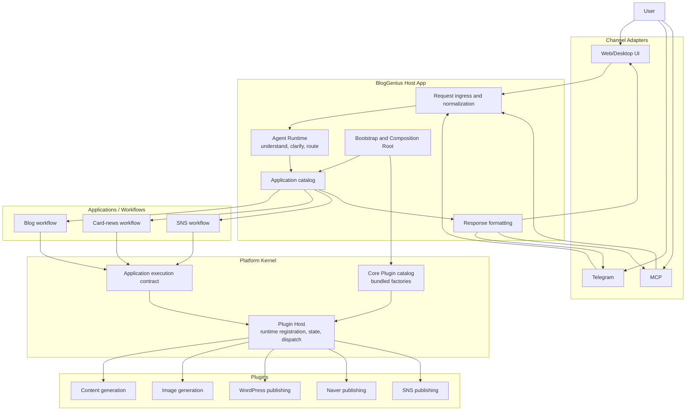

# Platform Kernel, Applications, and Plugins

## Purpose and status

BlogGenius is establishing a platform boundary that lets independently owned capabilities be composed into product use cases without placing every business workflow in the Core. This document defines the target direction, the first executable foundation slice, and a first provider Plugin pilot. Existing product application paths have not yet migrated and continue to use their current runtime.

The migration strategy is to establish the new boundaries in this repository and prove them with code and tests. Existing implementation is optional reference material, not a compatibility contract or a constraint on the new structure. Functions and paths may be replaced or removed when the new architecture is ready; separately owned user data and external side effects still require deliberate handling.

## Layers

### Platform Kernel

The Kernel owns the stable host-side contracts and execution boundary:

- Plugin registration and operation discovery.
- Descriptor and operation input/output contract validation.
- Dispatch to a declared operation.
- Plugin enable/disable lifecycle, including rejecting new calls while disabled and draining tracked calls during disable.
- Shared execution policy, confirmation, and context boundaries as those contracts are introduced.

The Kernel does not own content generation, publishing, or product-specific sequencing. It must remain smaller than the set of Applications it hosts.

Initial implementation: `src/platform/`. `src/plugins/` is the legacy/current Core Plugin capability host and is not yet replaced by this foundation.

### Applications

An Application owns a product use case and composes operations into a business flow. Blog publishing, card-news creation, and social sharing are candidate Applications. Generation and publishing are functional categories or stages that an Application may compose; they are not separate architecture layers.

Applications depend on the Kernel's operation invocation contract and do not import concrete Plugin implementations. The first content-publishing Application under `src/applications/examples/` is an architecture example only; it is not wired into BlogGenius product entry points.

### Plugins

A Plugin provides one or more bounded operations, for example text generation, image generation, WordPress publishing, or Naver publishing. “Plugin” describes the implementation/package form. “Core Plugin” and “Community Plugin” describe ownership and distribution:

- Core Plugins are first-party and bundled with BlogGenius. The host can enable/disable them at runtime; this does not imply exposing a toggle for every plugin. They are not individually installed or removed by users.
- Community Plugins are a later extension stage. Runtime package install/removal, trust, permissions, isolation, updates, and rollback are not part of this foundation.

Long-term, a Plugin package should be independently usable through an explicit public interface and must not import BlogGenius private modules. The foundation does not yet claim a stable external SDK or package compatibility guarantee.

### Agent Runtime and Channels

UI, Telegram, and MCP are channel adapters. They accept requests and use the shared Agent Runtime; they must not implement product workflows independently. The Agent Runtime interprets requests, selects an Application or asks the user for missing information, and consults the runtime capability/operation registry as the source of truth. The current Agent Runtime and channel implementations have not yet been moved onto this foundation.

## End-to-end architecture and request flow

“Host” refers to two related but different things. **BlogGenius Host App** is the product runtime that starts the system, accepts channel requests, chooses an Application, and owns composition. **Plugin Host** is a Kernel component that registers Plugin descriptors, exposes available operations, enforces enabled state, validates calls, and dispatches operations. The Plugin Host does not render UI or decide which product workflow a user means.

Target request and result flow:



In a successful flow, a channel adapter normalizes input, the Agent Runtime identifies the intent and asks for missing decisions when needed, and the Host App selects an Application. The Application owns the business sequence and requests operations through the Kernel contract. The Plugin Host checks registration and lifecycle state, validates and dispatches each operation, and returns results to the Application. The Host App formats the result for the originating channel. A request may stop for clarification or confirmation instead of invoking a Plugin.

The diagram is the agreed target, not a claim that every box or arrow is implemented. In particular, the new WordPress Application is not yet routed from the product UI, Telegram, or MCP. The current Agent/Capability path and the new Plugin Host are parallel systems during this architecture stage.

Today, operational product traffic still follows the existing control path:

```text
Existing UI / Telegram / MCP ingress -> Agent Runtime -> Capability Registry -> Execution Layer
                                                       -> Memory and channel-specific response
```

The new Kernel/Application path is currently exercised through examples and the WordPress pilot composition root; it does not yet receive normal product requests. For current Agent Runtime, capability, and memory ownership, see [`architecture/overview.md`](overview.md), [`architecture/agent-runtime.md`](agent-runtime.md), and [`architecture/memory-graph.md`](memory-graph.md).

## Directory ownership: target and current implementation

The target hierarchy assigns ownership by architectural boundary. It is not a list of directories that must all exist today.

```text
src/
  host/                         # BlogGenius Host App: bootstrap, ingress, routing, app catalog
  adapters/                     # Channel boundary implementations
    ui/
    telegram/
    mcp/
  agent/                        # Request understanding, clarification, Application selection
  platform/                     # Platform Kernel: contracts, Plugin Host, dispatch, lifecycle
  applications/                 # Product workflows; no concrete Plugin imports
  composition/                  # Host startup wiring: catalog factories, Applications, Kernel

packages/
  plugins/
    core/                       # Bundled first-party packages, independently bounded
    community/                  # Future third-party distribution; not implemented
```

Current source layout (only the paths relevant to this boundary):

```text
ui/                             # Existing Web UI assets and feature views
src/
  ui-runtime/                   # Existing UI runtime/bootstrap
  ui-api/                       # Existing UI-facing API routes, controllers, services
  gui/                          # Existing desktop GUI integration
  channels/telegram/            # Existing Telegram response renderer
  telegram-*.js                 # Existing Telegram services and bot integration at src root
  mcp/                          # Existing MCP servers, adapters, and runtime setup
  agent/                        # Existing Agent Runtime, request mapper, planning, confirmation
  capabilities/                 # Existing capability routing and execution boundary
  plugins/                      # Existing capability-contribution catalog and lifecycle host
  platform/                     # New Kernel Plugin contract and Plugin Host
  applications/
    examples/content-publishing.js
    wordpress-publishing.js     # New architecture example/pilot, not product-routed
    generated-wordpress-publishing.js # Pilot workflow composing generation and publication
  composition/
    content-publishing-example.js
    core-plugin-registry.js     # Explicit bundled Core Plugin inventory and ID-based factories
    plugin-runtime-composition.js # Selects and wires the Plugin set for one runtime composition
    wordpress-publishing.js     # Pilot composition root
    generated-wordpress-publishing.js # Pilot composition root for generation + publication

packages/plugins/core/
  wordpress-publisher/          # First independently bounded Plugin package
  content-generator/            # Provider-neutral text generation operation package
```

The target `src/host/` and `src/adapters/` directories do not exist yet. Existing UI, Telegram, and MCP paths should not be described as already migrated adapters merely because they have adapter-like responsibilities. Likewise, `src/plugins/` is the existing capability-contribution host, while `src/platform/plugin-host.js` is the new Kernel Plugin Host; they are not interchangeable. Do not create empty target directories or relocate current code for appearance alone. Add a target boundary when a real migration slice defines and tests its contract.

The initial foundation uses `src/applications/examples/`, `src/composition/`, and `src/test-fixtures/`. The WordPress pilot and explicit Core Plugin catalog validate package composition and runtime discovery, but do not migrate an existing product flow.

## Dependency direction

```text
Channel Adapter -> Agent Runtime -> Application -> Kernel operation contract -> Plugin operation
                                                ^
Composition Root wires concrete Applications and Plugins
```

- Plugin implementations depend on the public Plugin contract and their own provider libraries. They do not import Applications, channels, or BlogGenius-private modules.
- Applications depend on the operation invocation contract and compose calls. They do not import concrete Plugins.
- The Kernel does not depend on Applications, channels, or domain-specific implementations.
- Channels depend on Agent/Application invocation boundaries, not concrete Plugins.
- Composition roots are the only place that chooses and wires concrete Applications and Plugins.

Directory layout alone does not enforce these rules. Explicit interfaces, composition-root ownership, and contract/dependency tests must enforce them.

## Initial operation contract

The first in-process contract is intentionally small:

- Plugin descriptor: `id`, `name`, `version`, and a non-empty map of declared operations.
- Operation descriptor: a human-readable description, synchronous input/output parsers, and an async-capable executor.
- Composition selects required Plugin instances from the explicit bundled catalog; the Kernel Host registers that selected set, validates shape, and rejects duplicate plugin identifiers. Selection is explicit rather than implicitly constructing every catalog package. The runtime host does not expose package installation/removal.
- Dispatch is addressed by `pluginId` and `operationId`; the host validates/normalizes input and output through the declared parsers.
- `listOperations()` derives the available-operation catalog from registered descriptors and omits disabled or disabling plugins. No separate manually maintained capability list is needed for this foundation.
- Plugin execution errors pass through to the Application. Contract violations are reported as `PluginContractError`.
- The executor receives a narrow execution context (`AbortSignal` only at this stage); it does not receive the host's full dependency bag.
- `setEnabled(false)` blocks new executions immediately and waits for tracked operations to finish. It does not undo an external side effect already performed by an operation.

This is an initial in-process boundary, not a security sandbox. Parser functions are trusted code. The current interface is a foundation contract, not yet a semver-governed third-party SDK.

## Current implementation and migration boundary

- New foundation code: `src/platform/plugin-contract.js`, `src/platform/plugin-host.js`, the example Application and composition root, and `src/test-fixtures/platform-foundation/`.
- Existing `src/plugins/catalog.js` and `src/plugins/core-host.js` remain in use by `src/capabilities/index.js`. They gate current capability contributions. They are not replaced or wrapped by the new Kernel Plugin Host in this stage.
- The WordPress Publisher pilot lives at `packages/plugins/core/wordpress-publisher/`; it uses injected credentials and `fetch`, with no BlogGenius-private imports. Its REST operations cover media upload, category listing, and post creation.
- `packages/plugins/core/content-generator/` declares `text.generate` over a provider-neutral injected `generateText({ prompt, signal })` function. It validates prompt/result shape but does not own provider/model selection, credentials, prompt building, retries, or product workflow.
- `src/applications/wordpress-publishing.js` composes WordPress operations into a publishing use case. `src/composition/wordpress-publishing.js` wires the package to the Kernel. This pilot does not replace the current WordPress product paths: they still call `Core.publishToWordPress()`.
- `src/applications/generated-wordpress-publishing.js` composes text generation with the WordPress publishing Application through injected operation and publish interfaces. `src/composition/generated-wordpress-publishing.js` selects both Plugins, creates one Kernel Host, and wires the two Applications together. Its tests use a fake text provider and fake WordPress HTTP responses; it is not connected to a product entrypoint.
- The Application owns manuscript/asset preparation, category matching, warning collection, and draft fallback. The Plugin owns WordPress authentication and REST request/response behavior. Existing image optimization and FTC/CTA permanent-asset caching remain in the legacy Application/Core path; the pilot accepts already prepared `Buffer` assets and does not yet migrate those product concerns.
- Both Core Plugin directories have minimal package manifests and public interface READMEs. They have no third-party runtime dependency; descriptor versions come from package manifests. This validates package boundaries, but not semver compatibility policy or separate-repository releases.
- `src/composition/core-plugin-registry.js` is the explicit bundled Core Plugin catalog and ID-based factory boundary. It lists packages, checks registration, and creates one requested Plugin; it does not choose the Plugin set for a use case.
- `src/composition/core-plugin-runtime.js` joins that static catalog with one in-memory `PluginHost`. A process may inject the same runtime into multiple Application composition roots so registered Plugin instances, lifecycle, and operations have one shared owner. Application composition still selects only the Plugins it needs; discovery does not instantiate every catalog entry.
- `src/composition/plugin-runtime-composition.js` validates an explicit Plugin ID selection and its dependency map, then asks the catalog to create only those instances. Each Application composition root chooses its required Plugin set and supplies dependencies. The Kernel Plugin Host remains the source of truth for successfully registered runtime Plugins, lifecycle state, and available operations.
- The WordPress publishing composition selects only `wordpress-publisher`; the generated WordPress composition selects `content-generator` and `wordpress-publisher`. The catalog can list both without requiring every runtime composition to instantiate or configure both.
- The product UI currently lives across `ui/`, `src/ui-runtime/`, `src/ui-api/`, and `src/gui/`. Telegram and MCP also retain their existing roots as shown above. They have not yet been composed through a single new Host App ingress or routed into the new WordPress Application.
- Settings Beta has a read-only Plugin discovery view backed by `GET /api/v1/plugins/core` and `GET /api/v1/plugins/core/:id`. Static bundled metadata comes from the explicit catalog; loaded/enabled state and active execution count come from the shared runtime Host. It does not expose injected dependencies, credentials, or Application-to-Plugin relationships. Community Plugins remain hidden. The UI server creates a shared runtime for the new architecture, but existing publishing product flows have not yet migrated into it; until an Application registers a Plugin there, the UI reports that Plugin as not loaded rather than treating it as an error.
- Existing Naver, generation, SNS, card-news, automation, UI, Telegram, and MCP paths are unchanged.

## Next migration gate

The WordPress publishing pilot, content generation Plugin, and generated WordPress composition validate injected dependencies, catalog lookup, explicit runtime assembly, operation discovery, and a combined generation-and-publishing Application using fakes/mocks. They do not replace existing product flows. A later migration should implement the agreed new Application/Plugin contracts directly; existing manual, scheduled, and batch paths are references only and need not remain compatible. Identify separately owned user data and external side effects before replacing or removing those paths. Add Kernel contract elements only when required by concrete application flows and tests.

Community package loading, skill packaging, multi-host distribution, runtime install/removal, persistent lifecycle state, and process isolation require separate design decisions.
