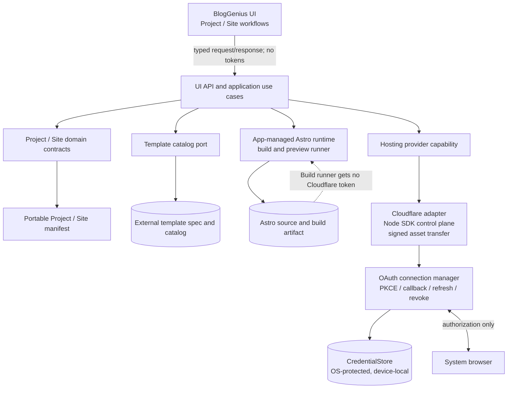

# Cloudflare 데스크톱 연결 통합

## Branch 및 상태

- Branch: `codex/cloudflare-desktop-connection`
- 시작일: 2026-10-02
- Base/parent branch: `codex/static-site-builder-main`
- 상태: 사용자 단위 Cloudflare OAuth 연결 및 설정 UI 구현 완료; 사용자 최종 UI 확인과 후속 Project/Site slice 대기
- 상위 feature 기록: [Static Site Builder 전체 계획](2026-10-01-static-site-builder-main-development.md)

## 사용자 필요와 목표

Cloudflare OAuth와 계정/Worker 조회, Static Assets 배포가 별도 PoC에서 확인됐다. 이를 BlogGenius의 실제 앱 흐름으로 연결하기 전에 첫 사용자 slice의 UX, 인증 상태 수명, credential 경계, SDK 포함 방식을 합의한다. 이 기록은 합의 전의 제안이며 확정 설계가 아니다.

### 사용자 합의 업데이트 (2026-10-02)

- Cloudflare OAuth 연결은 BlogGenius 사용자/설치 단위로 둔다. Cloudflare 사용자가 여러 account에 접근할 수 있으므로 Project마다 접근 가능한 account 하나를 선택하고, Site마다 Worker 배포 대상을 둔다.
- Astro build와 preview는 로컬에서 Cloudflare와 독립적으로 수행한다. Cloudflare 연결은 배포 시에만 요구한다.
- 가칭 Amade2는 BlogGenius가 참조하는 별도 template source repository다. 저작 도구나 CLI가 아니며, BlogGenius에 template catalog/source를 내장하지 않는다.
- Cloudflare 연결은 `설정 > 기본 연결 > 사이트 호스팅` 별도 하위 탭에 둔다. `블로그 발행 채널`에는 섞지 않는다. 지금은 Cloudflare만 지원하되 향후 hosting provider를 추가할 수 있도록 연결 영역을 분리한다.
- 사이트 호스팅 패널은 블로그 발행 채널과 같은 상단 readiness card → 상세 설정 card 구조를 쓴다. 지금은 Cloudflare 한 장으로 시작하고, 향후 호스팅 공급자별 카드를 같은 패턴으로 늘린다.
- 설정에서는 접근 가능한 계정 이름 목록과 `접근이 허용된 계정 N개를 확인했습니다.` 안내만 표시한다. Cloudflare Account ID 같은 내부 식별자는 숨기며, 계정 선택은 Project 생성/설정 단계에서 한다.
- 연결 해제 확인에는 앱 공통 dialog를 사용한다. 연결 안내와 성공 상태 문구는 배지·계정 목록과 중복되지 않도록 최소화한다.
- 첫 구현 slice는 사용자/설치 수준 Cloudflare OAuth 연결 및 접근 가능한 account 목록 확인이다. Project에 account 지정, Worker 선택/목록, 배포는 포함하지 않는다.
- 개발·검증은 사용자가 소유한 private OAuth client를 쓴다. Client ID를 저장소에 포함하지 않고 로컬 런타임 설정으로 전달한다.
- OAuth 연결은 system browser, Authorization Code + PKCE, `memberships.read offline_access`, 고정 callback `http://127.0.0.1:43127/oauth/callback`을 사용한다. refresh token은 Electron `safeStorage` 암호화 후 로컬 credential 파일에 보관하고 access token은 메모리에서만 유지한다.

## 범위

- 범위: system browser OAuth 연결, 연결된 Cloudflare account membership 읽기, 연결 상태를 `설정 > 기본 연결 > 사이트 호스팅`에서 표시한다.
- 범위: OS 보호 기능이 준비된 Electron `safeStorage`를 통해 refresh token을 암호화해 저장하고, refresh grant로 access token을 갱신한다.
- 비범위: Project/Site 구성·조회·배포는 별도 `사이트` surface에 둔다. Worker 목록/Static Assets 조회는 후속 slice다.

## 명시적 비목표

- Astro site 생성/편집, 외부 template catalog 연결, build/preview의 구현. 이들 작업은 Cloudflare 연결을 요구하지 않는 로컬 작업으로 설계한다.
- Worker 생성, 자산 업로드, 배포, 삭제 및 custom domain 변경. 이 branch는 읽기 전용이다.
- 계정 구성원 관리나 Cloudflare 외 다른 배포 공급자.
- OAuth client 공개화/도메인 검증. 제품 배포 전 별도 선결 과제로 추적한다.
- 개발용 OAuth client 설정과 실험이 끝나기 전에 refresh token의 수명·회전 규칙을 보장된 동작으로 가정하는 것.

## 제안 설계와 경계 (합의 대기)

- OAuth, token 저장 및 Cloudflare API 호출은 main process/service 계층에 두고, renderer에는 연결 상태와 비밀 제거된 계정/Worker 정보만 전달하는 안을 제안한다.
- 인증은 기존 PoC에서 검증된 시스템 브라우저, Authorization Code + PKCE, 등록된 loopback callback을 재사용하는 안이다. 성공 기준은 브라우저 탭 표시가 아니라 로컬 callback의 code 교환 성공이다.
- Cloudflare SDK를 작은 gateway/adapter 뒤에 두는 안을 제안한다. Static Assets 파일 전송은 이 읽기 전용 slice에 포함하지 않는다.
- Cloudflare token을 site source/build subprocess에 전달하지 않는 경계를 제안한다.
- OAuth Client ID는 설치형 앱에서 비밀로 취급할 수 없다. 특정 사용자의 비공개 테스트 Client ID를 제품 코드에 넣지 않는다.

### Token 갱신과 저장

- 이전 PoC client는 Authorization Code grant만 설정되어 있었고 응답에 refresh token이 없었다. 이를 Cloudflare OAuth 전체의 제한으로 일반화하지 않는다.
- Cloudflare OAuth Client API는 `authorization_code`에 더해 `refresh_token` grant type을 선택적으로 허용한다. `offline_access` protocol scope는 grant/response type 설정에 따라 자동 반영된다고 문서화되어 있다.
- 따라서 먼저 별도 개발용 client에서 PKCE + refresh grant를 구성해 발급 응답, 갱신 요청, 회전/재사용 규칙, revoke 동작을 실험한다. 현재 사용자의 PoC client는 변경하지 않는다.
- 제품 연결은 refresh token을 지원한다면 사용자 장비의 OS 보호 저장소에 보관하고, access token은 짧게 cache하며 만료 전에 갱신하는 방향을 제안한다.
- 제안: Electron `safeStorage`를 감싼 `CredentialStore` capability를 두고 refresh token을 device-local로 보관한다. 현재 타깃 macOS에서는 Keychain, Windows에서는 DPAPI를 사용하며 OS별 의미가 같지는 않다. Windows x64 검증을 포함하고 Windows ARM64는 추후 호환 목표로 둔다. 동기 API 대신 Electron이 권장하는 비동기 API를 사용하고, code signing과 키 일관성 영향도 검증한다.
- Windows DPAPI는 같은 Windows 사용자 권한에서 실행되는 다른 프로세스까지 막는 경계가 아니다. `safeStorage`를 “악성 로컬 프로그램으로부터 완전히 격리”로 설명하지 않는다.
- refresh grant를 쓸 수 없거나 회전/폐기 규칙이 제품 요구와 맞지 않으면 보관 기간과 재인증 UX를 사용자와 재합의한다.

### 전체 기능의 외부 및 기기 prerequisite

| 단계 | 사용자/운영 선행 조건 | BlogGenius 책임 |
| --- | --- | --- |
| 연결 | Cloudflare 사용자 계정, 해당 계정 접근 권한, 시스템 브라우저 로그인 | OAuth PKCE, 최소 권한 동의, 오류·권한 부족 안내 |
| 계정/Worker 읽기 | Memberships Read와 Workers Scripts Read 권한 | 멤버십 계정 선택, Worker/Static Assets 구분 |
| 최초 배포 | Workers Scripts Write 권한 | 배포 전에 대상 account, 새/기존 Worker, 변경 범위와 public URL 표시 및 확인 |
| custom domain(후속) | Cloudflare zone과 hostname 권한, DNS 상태 | 충돌을 찾아 설명하고 사용자가 승인한 변경만 요청 |
| Astro 편집/build(후속) | 쓸 수 있는 로컬 저장공간과 네트워크 연결; 사용자의 Node/Docker 설치는 요구하지 않음 | 앱 관리 toolchain의 플랫폼별 설치/검증, 로컬 preview/build 및 실패 복구 |
| 일반 배포 | 일반 Cloudflare 사용자가 OAuth할 수 있는 공개 OAuth client와 검증된 게시자 domain | 공개 Client ID 및 동의 화면 메타데이터를 release config에 포함 |

OAuth scope 후보는 최초 조회에 `memberships.read`와 `workers-scripts.read`, 배포 때 `workers-scripts.write`다. Domain 조작에 필요한 scope는 custom-domain 기능을 설계할 때 API별로 다시 확인한다. 가장 낮은 권한으로 시작할지, write scope를 첫 동의에서 요청할지, 첫 배포 때 추가 동의를 받을지는 아직 결정하지 않았다.

Cloudflare 공개 OAuth client는 비공개 client와 다르게 누구나 authorization할 수 있고, 공개 전 client name/logo/URL/scopes 등 요구 필드 및 domain 검증이 필요하다. 현재 private test client는 내부 개발에만 쓴다.

공식 문서는 desktop/mobile/CLI 앱에 Authorization Code + PKCE(`none`, S256)를 안내한다. OAuth client schema는 `refresh_token` grant type을 허용하고, grant/response type에 따라 client에서 `offline_access` protocol scope를 자동 반영한다. 다만 실제 authorization request에도 `offline_access`를 요청해야 refresh token이 발급되는 것을 실측했다. Cloudflare Static Assets는 Worker와 asset을 한 번의 배포 단위로 묶는다. 출처는 아래 공식 문서다.

### 사용자 설정과 내부 관리 정보

| 경계 | 사용자에게 보이거나 선택할 항목 | BlogGenius가 내부 관리할 값 |
| --- | --- | --- |
| Cloudflare 연결(사용자/설치 범위) | 연결/재연결/해제, 권한 범위 설명, 사용자 및 접근 가능한 account 목록 | OAuth client 설정, PKCE state, token 및 만료/갱신 metadata, 연결 상태 |
| Project | 이름, 연결 사용자가 접근 가능한 Cloudflare account 하나 선택, 단일 선택형 root domain(미지정 허용) | Project ID, 로컬 source root, 외부 template reference/version, account ID, domain 검증 결과 |
| Site | 표시 이름, template, template-defined settings(예: title/logo/menu), hostname label(선택) | Site ID, Worker name/ID, Astro config/build 경로, artifact manifest/hash, 배포 버전/status, workers.dev URL |
| 배포 action | 대상 Project/Site와 Preview/Production, 수행 전 변경 요약/승인 | idempotency/correlation ID, upload session metadata, deployment ID 및 결과 |

계정 연결은 사용자/설치 수준이고 Cloudflare account 선택은 Project의 속성으로 확정했다. 한 OAuth 연결이 여러 account에 접근할 수 있으며, 각 Project는 그중 하나를 지정한다. 서로 다른 Project는 각자 다른 account를 사용할 수 있다. 전역 기본 account는 두지 않는다.

### Software architecture 제안



- Product domain contracts (`Project`, `Site`, `BuildArtifact`, `DeploymentTarget`, `DeploymentResult`)는 Cloudflare SDK request/response type과 분리한다.
- `Hosting capability`는 현재 Cloudflare adapter 하나만 제공하되, 다른 hosting provider를 추가할 때 UI/domain model을 재작성하지 않도록 capability 계약을 먼저 작고 구체적으로 정의한다. provider를 과도하게 일반화하지 않는다.
- Template catalog/spec은 별도 project의 소유다. BlogGenius는 template authoring을 하지 않고 versioned reference와 제한된 settings contract를 소비한다.
- Site source는 사용자가 Astro 편집 도구에서도 열 수 있는 보통의 Astro project다. Project/Site manifest는 source와 함께 이동 가능하고, Cloudflare account/Worker ID 등 non-secret target metadata만 기록한다. OAuth token은 manifest/export에 포함하지 않는다.
- Template catalog schema(템플릿이 노출하는 configurable values)와 사용자의 Project/Site manifest(선택한 template/version, root domain, site/hosting target)는 서로 다른 contract로 분리한다. BlogGenius는 외부 template source repository(가칭 Amade2)의 catalog/source를 참조한다. 별도 도구와 manifest를 공동 소비하는 일은 현재 범위가 아니다.
- Export/import가 제공되면 source와 manifest를 함께 이동하고 token, OS credential, dependency cache, build output은 옮기지 않는 방향이다. 새 기기에서는 재연결 후 Project의 target account 접근을 확인한다.
- Astro build/preview child process에는 Cloudflare access/refresh token을 환경 변수나 파일로 넘기지 않는다. 배포 adapter만 credential을 사용하고 build artifact의 경로·manifest를 받는다.
- Project/Site repository와 OAuth credential lifecycle은 별도 소유권이다. OS credential은 해당 기기에 남으며 project export/import 대상으로 취급하지 않는다.
- SDK를 쓰더라도 PoC에서 확인한 서명된 binary asset upload transport는 별도 module로 캡슐화한다. SDK version, SDK pagination/type mismatch, package size와 API 변경을 adapter contract tests로 통제한다.
- Cloudflare Static Assets는 Worker와 정적 asset을 한 deployment unit으로 배포하는 모델이다. BlogGenius 내부 model에서는 Site를 하나의 Worker+assets deployment unit에 대응시키되, UI는 Cloudflare 내부 구현용어보다 `사이트`를 우선해 보여준다.
- Build runtime은 Cloudflare와 독립된 로컬 실행이며 사용자에게 Node/npm/Docker 설치를 요구하지 않는 앱 관리 방식이 목표다. 이 방식의 OS별 설치/업데이트/격리 가능성은 별도 runtime feasibility stage에서 검증한다.
- Astro/npm build는 template와 사용자가 편집한 project code를 실행한다. 별도 child process에 Cloudflare token을 주지 않는 것은 최소 경계지만, 같은 사용자 권한으로 실행되는 임의의 npm script에 대한 완전한 sandbox는 아니다. Template source integrity/검증 정책, 설치 lifecycle script, 파일·네트워크 접근, Windows/macOS sandbox 가능성을 조사하기 전에는 “안전한 격리 build”라고 약속하지 않는다.

local Astro runtime 구현 후보는 다음과 같다. (a) BlogGenius에 호환 Node runtime과 package manager를 포함하고 site별 의존성을 관리한다. 제품의 무설치 목표를 가장 잘 맞추지만 platform별 업데이트/용량, native dependency 호환, 임의 script 실행 위험을 앱이 책임진다. (b) 빌드를 원격 서비스로 보낸다. local toolchain은 단순해질 수 있지만 source upload, privacy, 비용, service operation이 생긴다. (c) Docker를 요구한다. 격리는 쉬워질 수 있어도 BlogGenius만 설치한다는 방향과 어긋나 초기 앱에서는 제외한다. 현재는 (a)를 우선 실험 후보로 두되 OS isolation을 포함한 feasibility 결과 전에 확정하지 않는다.

### UI/사용자 흐름 제안

상위 navigation은 다음처럼 분리하는 안을 권한다.

```text
기존 BlogGenius 기능: 글쓰기 / 블로그 발행
새 Sites 기능:       프로젝트 / 사이트 / preview / build / 배포
설정:                Cloudflare 연결 및 권한 상태
```

Cloudflare OAuth 연결은 설정 화면에서 한 번 관리하고, 연결된 사용자가 접근 가능한 Cloudflare account 중 하나를 각 Project에서 선택한다. 로컬 build/preview는 연결 없이 가능하며 배포 때만 연결을 요구한다. Worker 목록은 일반 연결 설정에 상시 노출하기보다 Sites 프로젝트의 대상 선택/기존 리소스 연결 흐름에서 제공한다.

#### 1. 설정 > 외부 서비스: Cloudflare 연결

```text
Cloudflare
연결 안 됨
Cloudflare에 배포할 때 계정을 연결합니다. 로컬 build/preview에는 연결이 필요하지 않습니다.
[Cloudflare 연결]

연결 후:
Cloudflare 계정 연결됨 · 마지막 확인 시각
연결된 계정 2개 (세부 권한: 읽기)
[다시 연결] [연결 해제]
```

동의 화면을 열기 전에 요청 권한을 앱 안에서 한국어로 설명한다. 권한 오류는 `다시 연결`, 계정 관리자 제한, scope 미승인 중 어느 조치가 필요한지 가능한 범위에서 구분한다. 연결 해제는 이 기기의 저장 credential 삭제와 Cloudflare authorization revoke를 분리해 설명한다.

#### 2. Project 만들기/설정

```text
프로젝트 이름     [개인 블로그]
Cloudflare 계정   [계정 선택 ▾]
기본 도메인       [아직 설정하지 않음]  (선택)
```

도메인이 없어도 만들고 `workers.dev`에서 확인할 수 있다. root domain은 Project당 0 또는 1개이며, 별도 root domain은 별도 Project라는 기존 합의에 맞춘다.

#### 3. Site 추가

```text
template       [template catalog에서 선택]
site 이름      [제품 홈페이지]
hostname       [www] (선택; Project root domain이 설정된 경우)
template 설정  [title, logo, menu ... catalog schema에 따라 생성]
```

`www`와 apex는 다른 hostname이라는 안내가 필요하다. Apex redirect/alias 처리는 별도 기능으로 둔다. Template 설정 입력 UI는 catalog schema-driven으로 만들고 특정 template의 field를 BlogGenius 코드에 고정하지 않는다.

#### 4. Preview와 배포

- Preview는 로컬 build artifact를 browser로 열고 Cloudflare에 자원을 만들지 않는다.
- 배포 확인 단계에는 Cloudflare account, Site/Worker name, URL, create/update 판단, asset 파일 수/총 크기, 선택 hostname, 권한 요청을 보여준다.
- 완료 화면에는 `workers.dev` URL, version/deploy 상태, custom-domain 부가 상태를 표시한다.
- 글 발행 후는 기존 콘텐츠 작업과 Site build/deploy 작업을 느슨하게 연결한다. 글 원본 저장 성공과 원격 deploy 성공은 별도 결과로 보여준다.

#### UI 상태 계약 후보

| 상태 | 사용자 표시/행동 |
| --- | --- |
| 앱 OAuth 설정 없음 | Cloudflare 연결을 비활성화하고 앱 업데이트/설정 문제임을 안내 |
| 연결 안 됨 | 연결 목적과 요청 권한을 안내하고 시스템 브라우저 인증 시작 |
| 인증 진행 중 | 브라우저에서 로그인/동의 중임을 표시, 취소 가능 |
| 연결됨 | 계정 목록과 권한 종류(read/write), 마지막 확인 시각 표시 |
| 다시 연결 필요 | token 만료/철회 또는 refresh 실패 원인을 알리고 재연결 제공 |
| 일부 권한 부족 | 가능한 조회/기능은 유지하고 필요한 scope를 구체적으로 표시 |
| Cloudflare 일시 오류 | 연결 데이터를 삭제하지 않고 재시도 제공 |

실제 화면 디자인은 이 상태 계약을 기준으로 기존 `settings-next` 컴포넌트와 새 Sites 화면의 navigation/style pattern을 확인한 후 별도 UI review slice로 만든다. 이번 단계에서 새 시각 디자인을 임의로 확정하지 않는다.

## 결정이 필요한 항목

1. 첫 제품 slice를 Cloudflare OAuth 연결 + account/Worker 조회까지로 한정하는가? (방향 합의: 예)
2. 기존 client를 수정하지 않고 별도 개발용 OAuth Client로 `refresh_token` grant 발급/갱신/회전을 검증할까?
3. OAuth consent에서 읽기 권한만 먼저 받고 배포 시 write 권한을 추가할지, 첫 연결 때 read/write를 함께 요청할지?
4. Project가 Cloudflare account 하나를 선택하고 Site가 Worker 배포 대상을 갖는 모델에 동의하는가? (합의됨)
5. 연결 정보는 refresh token까지 OS credential store에 저장하고 access token만 메모리 cache 하는가? (제안: Cloudflare refresh grant 검증 후 OS 보관)
6. Site 관리의 첫 화면을 설정의 발행 채널이 아니라 새 top-level `Sites` surface로 둘지? 연결 설정은 설정에 두고 Project/Site 관리만 별도 surface로 분리하는 안을 권한다.
7. OAuth 공개 client 및 Client ID 공급은 제품 출시 선결조건으로 관리하되, 내부 개발용 private client를 계속 사용할까?
8. Template/npm project code를 사용자가 직접 실행하는 기능으로 고지하고, trust policy를 둘 것인가? 어떤 OS sandbox를 배포 요구사항으로 둘까?
9. Cloudflare refresh token은 credential store abstraction 뒤에서만 읽게 하고, 실제 OS 저장은 `safeStorage`를 우선 검증하는 안에 동의하는가?
10. 외부 template repository(가칭 Amade2)가 template source/catalog를 소유하고 BlogGenius가 참조한다. 별도 CLI/공동 소비자는 현재 범위가 아니다.
11. Runtime feasibility에서는 앱 관리 local Node runtime을 우선 검증한다. 원격 build는 현재 합의된 기본 경로가 아니다.

## 참고 자료 (Cloudflare 공식 문서)

- [OAuth client 생성, desktop PKCE 및 public visibility](https://developers.cloudflare.com/fundamentals/oauth/create-an-oauth-client/)
- [OAuth client API: `refresh_token` grant와 `offline_access`](https://developers.cloudflare.com/api/resources/iam/subresources/oauth_clients/)
- [OpenID Connect Core: `offline_access` scope 의미](https://openid.net/specs/openid-connect-core-1_0.html#OfflineAccess)
- [OAuth authorization, 계정 선택 및 revoke](https://developers.cloudflare.com/fundamentals/oauth/authorizing-an-application/)
- [Workers Static Assets 개요와 배포 단위](https://developers.cloudflare.com/workers/static-assets/)
- [Self-managed OAuth client 공개 전환 안내](https://developers.cloudflare.com/changelog/post/2026-06-03-public-oauth-clients/)
- [Electron `safeStorage`: 비동기 credential 암호화와 OS별 보호 모델](https://www.electronjs.org/docs/latest/api/safe-storage)

## 결정 및 tradeoff

- 전체 feature는 `codex/static-site-builder-main`에 통합하고 독립 구현 단계를 sub-feature branch로 만든다.
- BlogGenius는 Amade CLI/Docker를 호출하지 않는다.
- SDK PoC에서는 OAuth access token이 약 1시간 유효했고 refresh token은 발급되지 않았다. 이는 테스트 client에서 관찰한 결과이며 제품 client의 장기 token 정책으로 일반화하지 않는다. SDK PoC 기록은 [Cloudflare Node SDK 통합 PoC](2026-10-02-cloudflare-node-sdk-integration-poc-development.md)를 참고한다.
- 현재 OAuth client는 비공개 테스트용이며 소유 계정 구성원만 쓸 수 있다. 일반 사용자 배포를 위해 Cloudflare의 공개 client 요건과 검증된 client URL이 필요하다. 사용자 계정의 client를 변경하지 않고 제품 client 준비를 별도 후속 결정으로 둔다.
- 사용자는 첫 사용자 시나리오를 통한 실제 기술 검증을 승인했으며 SDK PoC의 샘플 배포까지 승인했다. 이 branch의 기본 범위는 읽기 전용이며 원격 자원 변경은 별도 승인 없이는 하지 않는다.

## 논의 및 구현 제안 단계

1. Cloudflare OAuth token 갱신 및 revoke를 private 개발용 client에서 검증한다. (완료)
2. 설정 하위 탭과 첫 구현 slice 범위를 합의한다. (완료)
3. OAuth service, credential storage, API contract를 구현한다. (진행 중)
4. 설정에 사이트 호스팅 탭, 연결 상태, account 목록을 구현한다. (진행 중)
5. 사용자가 system browser OAuth와 UI를 직접 확인한다. (미완료)
6. 이후 sub-feature에서 Project account binding, Worker 선택/조회, 배포를 진행한다.

## 진행 상황

- 2026-10-02: SDK PoC를 상위 branch에 병합한 뒤 이 branch를 상위 `codex/static-site-builder-main`에서 생성했다.
- 2026-10-02: 사용자 요청으로 통합 단계의 범위 정리를 시작했다. 우선 후보는 시스템 브라우저 OAuth, 계정 연결, 계정별 Worker/Static Assets 조회다.
- 2026-10-02: private Cloudflare OAuth client에서 Authorization Code + PKCE, `offline_access`, refresh 회전, revoke를 REST로 검증했다. UI integration은 Cloudflare SDK가 아닌 OAuth REST와 memberships API를 사용한다.
- 2026-10-02: 사용자 승인에 따라 별도 `사이트 호스팅` 탭에서 OAuth 연결과 account 목록까지만 구현한다. Worker/API와 Project 연결은 다음 slice에 둔다.
- 완료: 기본 연결에 `사이트 호스팅` 하위 탭을 추가하고 Cloudflare 연결, 접근 계정 목록, 재연결 및 연결 해제 action을 구성했다. 다른 hosting provider를 추가할 수 있도록 블로그 채널과 별도 panel/service boundary를 유지한다.
- 완료: 연결된 계정 수 안내를 짧은 문구로 정리하고 계정 ID 노출을 제거했다. 이 화면은 접근 가능한 계정을 보여주기만 하며, 계정 지정은 Project 단계에서 한다.
- 완료: 연결 해제 확인을 브라우저 시스템 dialog에서 앱 공통 dialog로 바꾸고, 중복 문구와 성공 피드백을 제거했다. 카드에는 목적을 설명하는 한 줄을 두고, 연결 상태는 배지와 접근 가능한 계정 수로 전달한다.
- 완료: 디자인 가이드의 readiness summary 1:1 상세 카드 패턴에 맞춰 상단 Cloudflare 상태 카드를 추가했다. 해당 카드는 상세 설정으로 이동하고 연결 상태에 맞춰 요약과 dot을 갱신한다.
- 완료: UI API/service에서 Authorization Code + PKCE와 loopback callback을 처리한다. scope는 `memberships.read offline_access`이며 계정 목록은 Cloudflare Memberships REST API에서 pagination을 읽는다. OAuth/계정 API는 현재 별도 Cloudflare SDK dependency를 추가하지 않았다.
- 완료: refresh token은 Electron `safeStorage`의 비동기 암복호화로 OS 보호 credential file에 저장한다. access token은 메모리에만 두고, refresh rotation·병렬 갱신 잠금·로컬 callback/API 경계를 처리한다.
- 완료: OAuth Client ID는 `CLOUDFLARE_OAUTH_CLIENT_ID` 환경변수에서 읽는다. 사용자가 `.env.oauth`에 값을 넣고 `./run_dev.sh`를 실행하면 Development launcher가 앱 프로세스에 전달한다. 이 값은 Local/Development allowlist에만 포함하고 Production launcher는 `.env.oauth`에서 Cloudflare ID를 읽지 않는다. private test ID는 코드/문서에 저장하지 않는다. 일반 사용자 배포용 BlogGenius-owned public client와 release build 공급값은 후속 작업이다.
- 정적 확인: 변경 JavaScript 파일에 `node --check`, 전체 작업 diff에 `git diff --check`를 수행했다. 기능 test suite는 실행하지 않았다.
- 사용자 확인: 시스템 브라우저 OAuth 승인을 완료했고 Cloudflare 계정 목록이 설정 화면에 표시되는 것을 확인했다. 앱 공통 확인 dialog, 간결한 안내, readiness summary 카드를 반영했다.
- 후속 UI 확인: 사용자는 최종 카드 스타일과 연결 해제 동작을 직접 확인할 수 있다. OAuth 거부와 callback port 충돌 등 오류 복구 확인은 후속 검증에 남긴다.
- 후속: Project에 계정 연결, Worker 조회/선택, 실제 배포, Client ID release configuration 및 UI browser regressions를 별도 slice로 설계한다.
- 2026-10-02: 기존 설정 UI, UI API service 구조, Google OAuth loopback/PKCE 흐름과 자격 증명 경계를 조사했다.
- 2026-10-02: 사용자가 구현보다 계획 공유와 합의를 먼저 하도록 순서를 조정했다. 제품 코드와 의존성 변경은 이 기록에서 제거했다.
- 2026-10-02: Cloudflare OAuth Client API에서 refresh token grant 및 `offline_access` 처리가 선택적으로 지원됨을 확인했다. 이전 PoC client 설정에서는 refresh가 안 나왔으므로 그 관찰을 OAuth 전체의 제한으로 보지 않도록 기존 가설을 수정했다. 별도 client 변경 및 refresh live test는 하지 않았다.
- 2026-10-02: 최신 사용자 합의가 이전 제안 중 충돌하는 내용보다 우선한다. OAuth는 사용자/설치 단위, Cloudflare account 선택은 Project 단위(한 Project에 하나), Worker 배포 대상은 Site 단위다. Local Astro build/preview는 Cloudflare 연결 없이 수행한다. 가칭 Amade2는 template source repository만 뜻하며 CLI/저작 도구/BlogGenius 내장 catalog를 의미하지 않는다.
- 2026-10-02: Cloudflare 연결 설정과 Project/Site 관리 화면을 분리하는 UI direction, OS credential-store abstraction 후보, Astro/npm 실행의 trust/sandbox 위험, Project/Site manifest와 template catalog의 contract 분리 필요성을 설계 제안으로 기록했다.
- 2026-10-02: 사용자가 별도 비공개 refresh-token 검증 Client를 생성했다. 설정은 Code response, Authorization Code + Refresh Token grants, None (PKCE), 기존 loopback callback, Memberships Read scope다. Client ID는 문서에 기록하지 않는다.
- 2026-10-02: `prototypes/cloudflare-oauth-poc/run-refresh-token-check.js`로 실계정 검증을 완료했다. 첫 요청에는 `memberships.read`만 넣어 refresh token이 발급되지 않았다. authorization URL에 `offline_access`와 `prompt=consent`를 추가한 두 번째 요청에서는 refresh token이 발급됐고, Memberships Read, refresh 교환, 회전, revoke(HTTP 200), revoke 후 재사용 거부까지 모두 성공했다. token 원문은 출력하거나 저장하지 않았다.

## Refresh Token 검증 결과

검증용 client는 비공개로 유지하고 Authorization Code + PKCE(`none`/S256), response type `code`, loopback callback을 사용했다. client grant에는 `authorization_code`와 `refresh_token`이 모두 허용되어 있었다. authorization request에 `memberships.read`만 보냈을 때는 access token만 발급됐다. `offline_access`를 함께 요청하자 refresh token도 발급됐다. 즉 client가 grant를 허용하는 설정과 개별 authorization 요청의 scope 지정은 별개다.

Cloudflare consent 화면에는 Memberships Read만 사용자 권한으로 표시됐다. `offline_access`는 refresh 발급 요청을 위한 protocol scope이며 별도 Cloudflare API permission처럼 표시되지 않았다. Client ID는 문서에 기록하지 않는다.

성공 기준은 모두 확인했다: authorization code 교환, refresh token 발급, Memberships Read(계정 1개), refresh grant 성공, refresh token 회전, revoke 성공(HTTP 200), revoke된 token의 재사용 거부. 검증 과정에서 생성한 refresh token은 스크립트가 revoke했고 원문은 터미널·문서·로그에 남기지 않았다.

## 검증 및 남은 위험

- 자동 검증: `node --check prototypes/cloudflare-oauth-poc/run-refresh-token-check.js` 통과. 실제 Cloudflare 흐름에서 위 OAuth/refresh/revoke 성공 기준을 모두 확인했다.
- 수동 확인: 구현 뒤 macOS 시스템 브라우저에서 실제 OAuth 연결, 계정 선택, Worker/Static Assets 목록, 만료 및 연결 해제 상태 확인.
- 위험: 현재 OAuth Client는 비공개 테스트용이므로 임의 사용자는 authorization할 수 없다. refresh grant/rotation/revoke 동작은 검증했지만 token의 최대 수명·정책은 제품 요구를 위해 별도 확인한다. Astro/npm script는 로컬 사용자 권한으로 project code를 실행한다.
- 미결정: 공개 OAuth Client 등록/검증, token store 구현, SDK의 최종 dependency 및 실제 앱 크기, OS sandbox/trust policy, Windows x64 연결·credential 저장 검증.
