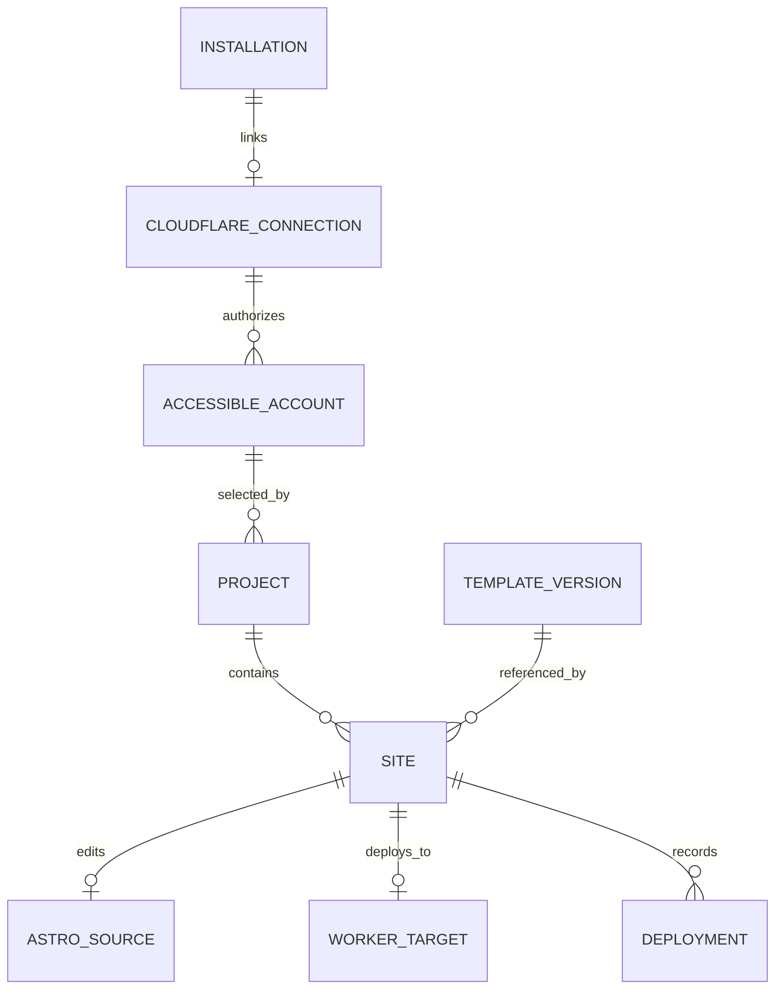
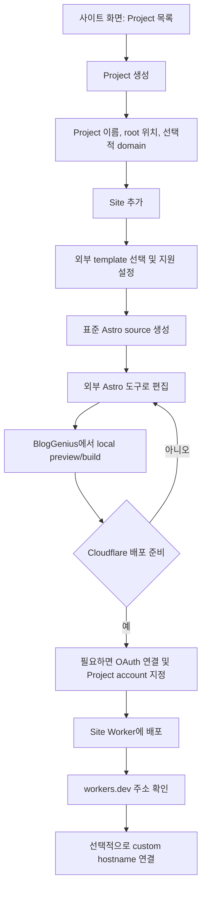

# Project/Site 데이터 모델 및 사용자 흐름 설계

## Branch 및 상태

- Branch: `codex/project-site-model-and-flow`
- 시작일: 2026-10-02
- Base/parent branch: `codex/static-site-builder-main`
- 상태: 설계 단계 완료; 세부 계약은 구현 slice에서 보완
- 상위 feature 기록: [Static Site Builder 전체 계획](2026-10-01-static-site-builder-main-development.md)

## 사용자 필요와 목표

BlogGenius 안에서 사용자가 Project와 Site를 이해하고 관리할 수 있도록 개념과 수명주기를 정리한다. Project는 관리 묶음이며 Site는 독립적인 build/deploy 단위라는 방향을 구체적인 데이터 소유권, 사용자 입력, 기본 흐름으로 연결한다. 설계는 현재 BlogGenius의 저장소·설정·UI 구조를 조사해 앱에 자연스럽게 통합하고, 이후 구현과 migration 논의의 기준으로 삼는다.

진행 순서는 `논의 → 필요한 확인/실험 → 사용자와 합의 → 설계 확정 → 범위 결정 → 구현 → 검증`이다. 사용자 합의 전에 제품 코드를 구현하지 않는다. 이 설계 단계에서 사용자가 명시적으로 합의한 항목은 현재 기준으로 기록하고, 열린 세부 계약은 후보/미결정으로 남겨 후속 구현 slice에서 보완한다.

## 범위

- Project와 Site의 역할, cardinality, 식별자와 관계를 정의한다.
- 사용자가 직접 정하는 값과 앱이 파생·관리하는 값을 구분한다.
- Project 생성, Site 추가, template 선택 및 기본 설정, local preview/build, 배포 준비로 이어지는 사용자 흐름을 설계한다.
- Cloudflare 연결(사용자/설치 단위), Project별 Cloudflare account 선택, Site별 Worker 배포 대상 경계를 반영한다.
- custom domain 없이 `workers.dev`로 먼저 확인할 수 있는 흐름과 Project domain/hostname 규칙을 다룬다.
- 기존 BlogGenius의 영속성, 설정, UI navigation 및 feature boundary를 조사해 후보 설계와 tradeoff를 문서화한다.
- 아직 모호하거나 상충하는 기존 합의는 결정된 사실처럼 정하지 않고 사용자와 확인할 질문으로 남긴다.

## 명시적 비목표

- 이 단계에서는 제품 코드, 데이터 migration, Project/Site CRUD UI를 구현하지 않는다.
- Astro runtime 설치·build/preview 구현, Cloudflare API 배포 및 custom-domain mutation을 다루지 않는다.
- template catalog/spec 또는 template switching/upgrade 계약을 확정하지 않는다. Project/Site 모델이 필요한 연결점만 식별한다.
- 블로그 원고의 static-site content mapping, 예약/삭제/redeploy 계약을 확정하지 않는다.
- 사용자 합의 없이 domain cardinality, apex 지원, 삭제 cascade, 공유/동기화 동작을 확정하지 않는다.

## 현재 합의와 설계 입력

- Project는 관리 묶음이고 Site는 실제 build/deploy 단위다. Project 안에는 여러 Site가 있을 수 있다.
- Cloudflare OAuth 연결은 사용자/설치 단위다. 하나의 OAuth 연결로 접근 가능한 계정이 여러 개일 수 있으며, Project마다 그중 Cloudflare account 하나를 선택한다.
- 각 Site는 자체 Cloudflare Worker 배포 대상을 갖는다. local build/preview는 Cloudflare 연결과 무관하다.
- Cloudflare 연결과 Project account binding은 원격 배포 전에만 필요하다. Project/Site 생성, 편집, local build/preview는 연결 없이 가능해야 한다.
- 사용자 흐름은 custom domain 없이도 완성되어야 한다. 기본 배포를 `workers.dev`에서 확인할 수 있다.
- custom domain과 site hostname은 분리된 개념으로 논의했다. `www`도 허용하고 apex 처리는 별도 기능으로 다룬다.
- Site source는 기본적으로 같은 기기의 Astro project를 외부 편집 도구와 공유한다. 다른 기기로 옮길 때 export/import를 제공하는 방향이다.
- BlogGenius는 site builder가 아니다. 외부 template repository의 catalog를 참조하고 제한된 template 설정만 받는다.
- 기존 합의 기록은 [상위 계획의 사용자 흐름/사이트 속성 초안](2026-10-01-static-site-builder-main-development.md)을 참고하되, 기록의 초안과 최신 합의 사이의 모호함은 검증한다.

## 사용자 논의 메모 (2026-10-02, 아직 구현/최종 계약 전)

- Cloudflare는 원격 배포에만 필요하다. Site 생성, 편집, local build와 preview는 계정 연결 없이 동작해야 한다.
- Site와 Worker를 1:1로 대응시키는 안을 논의 중이다. 이 정책을 따르면 BlogGenius가 Site별 Worker를 생성·관리하고, 이름 충돌 때 기존 Worker를 덮어쓰지 않는 기본 규칙이 필요하다. 기존 Worker를 선택해 Site를 붙이는 것은 초기 범위에서 제외하는 안을 검토한다.
- Project에는 최대 하나의 실제 custom root domain을 설정할 수 있고, 없어도 Site는 각자의 `workers.dev` 주소에서 확인할 수 있다. `workers.dev` 주소는 사용자 입력값이 아니라 Site 이름/ID와 Cloudflare 계정 설정을 이용해 만들거나 배포 후 조회한다.
- Site 폴더는 BlogGenius metadata와 Astro source를 모두 포함하는 하나의 portable한 Site 정의가 될 수 있어야 한다. 단, 일반 Astro 도구가 읽는 root 구조는 표준 `package.json`, `astro.config.*`, `src/`, `public/` 형태를 유지한다.
- Site/Project 삭제는 metadata만 제거할지 실제 source와 Cloudflare 자원까지 삭제할지 구분해야 한다. 보관/삭제 범위가 사용자에게 명확해야 한다.
- 기본 저장 구조는 `workspace/site-hosting/projects/{project_id}/sites/{site_id}`로 해 site hosting 데이터임을 드러낸다. 사용자가 Project별 root 경로를 지정하면 그 Project root 아래에 같은 `sites/{site_id}` 구조를 둔다. Site별 경로 선택은 기본 흐름에 넣지 않는다.

### 저장 위치 선택지와 제안 (2026-10-02 추가 논의)

| 선택지 | 장점 | 부담/위험 |
| --- | --- | --- |
| 1. 모든 Project/Site 경로를 BlogGenius 내부 규정으로 결정 | 입력이 없고 저장·정리 정책이 일관된다 | 사용자가 프로젝트 파일을 찾거나 다른 도구에서 열기 어려울 수 있고 앱 데이터 위치/용량에 묶인다 |
| 2. Project마다 top parent folder를 지정하고 Site를 그 아래 생성 | 관리 묶음과 파일 경계가 일치한다. 같은 Project의 Site를 찾고 백업·공유·이동하거나 Project 단위 package로 다루기 쉽다. Site별 위치를 반복해서 정하지 않는다 | Project 생성 시 파일 위치 결정을 요구할 수 있고, 사용자가 폴더를 이동·삭제한 경우 경로 재연결이 필요하다 |
| 3. Site마다 top parent folder를 지정 | Site를 각자 다른 위치나 기존 작업 공간에 놓을 수 있다 | Project 내 파일이 흩어지고 backup/export/import, Project 삭제·이동, 누락 source 복구를 어렵게 만든다 |

**데이터/패키지 경계로는 2안을 추천한다.** Project가 관리하는 Site들이 하나의 Project root 아래에 모이면 Project 단위 백업/이동과 추후 Project package 구성이 쉽고, 각 Site 디렉터리는 표준 Astro project root로 독립시킬 수 있다. 3안은 초기 기본 모델로는 Site 파일과 부모 Project 메타데이터를 흩뜨려 비용이 크다.

사용자 경험은 **2안의 경계를 채택하되, 경로 입력을 필수 결정으로 만들지 않는 절충안**을 검토한다. Project 생성에서 BlogGenius가 제안하는 기본 경로를 미리 보여주고 그대로 진행할 수 있게 하며, 사용자가 원할 때만 다른 Project root를 선택한다. Site 추가에서는 경로를 다시 묻지 않고 Project root 하위에 자동 생성한다. 저장 위치를 숨기지 않도록 Project/Site 화면에 `폴더 열기` 동작을 제공한다. 기본 경로를 어느 OS 위치로 할지(사용자 Documents vs app-managed workspace)는 별도 UX/패키징 확인 대상이다.

Project root는 경로 자체가 아니라 내부 manifest의 stable Project ID로 식별한다. 앱이 경로를 기억하되 manifest의 ID가 같은 폴더를 다시 선택해 연결할 수 있는 복구 경로를 둔다. 절대 경로를 Project/Site package 내부에 identity처럼 기록하지 않는다. 위 절충안도 사용자 합의 전이다.

### Site package 후보

```text
workspace/                              # default root parent
  site-hosting/
    projects/
    {project_id}/                       # default Project root
      project.json
      sites/
        {site_id}/                      # standard Astro project root
          package.json
          astro.config.mjs
          src/
          public/
          .bloggenius/
            site.json
```

사용자가 Project별 다른 root 경로를 지정하면 같은 구조를 그 위치에 둔다.

```text
{user-selected-project-root}/
  project.json
  sites/{site_id}/                      # standard Astro project root
    package.json
    astro.config.mjs
    src/
    public/
    .bloggenius/
      site.json                    # BlogGenius 전용 metadata/schema version
```

Project root는 `project.json`과 여러 Site package를 포함하고, Site package 전체도 개별 단위로 보관·복사·내보낼 수 있다. Astro tooling은 `sites/{site_id}/` 폴더를 project root로 인식한다. BlogGenius metadata는 숨겨진 전용 하위 폴더에서 Astro 파일과 구분하고, token 및 머신별 절대 경로는 포함하지 않는다. 실제 빌드 output, `node_modules`, package format은 별도 용량/재현성 확인 뒤 정한다.

Project별 사용자 지정 경로가 가능하면 앱이 Project를 열 때 `workspace/site-hosting/projects/`만 검색해서는 충분하지 않다. `Project ID → local root path`를 보관하는 machine-local registry가 필요할 수 있다. portable `project.json`에는 절대 경로를 넣지 않는 편이 Project 폴더 이동과 export/import에 유리하다. Project metadata에는 stable ID, 표시 이름, domain 설정, Cloudflare account ID, schema version/timestamps 등을 두고 OAuth token은 포함하지 않는다.

### 보관/삭제 제안

- 기본 동작은 Project/Site를 관리 화면에서 숨기는 reversible archive로 하고 로컬 Site package, custom-domain 연결, Cloudflare Worker를 자동 삭제하지 않는다.
- 영구 삭제가 필요할 때는 `BlogGenius metadata`, `local Astro files`, `Cloudflare Worker/domain attachment`를 별도 영향 항목으로 보여주고 사용자 선택을 받는다. 원격 Worker 삭제는 독립적인 명시 승인 없이는 실행하지 않는다.
- Project archive가 Site metadata를 함께 archive할지, Site를 다른 Project로 이동할 수 있게 할지는 관계 규칙과 함께 확정한다.

이는 현재의 추천이지 합의 완료가 아니다.

## 설계 경계와 주요 질문

## 기존 앱 구조 조사

- 앱의 local workspace는 `CONFIG.WORKSPACE_DIR`로 경로가 정해지고, 카드뉴스 데이터는 `workspace/card-news/projects/{id}/project.json`처럼 ID별 디렉터리에 분리한다. 단일 aggregate JSON을 계속 키우지 않는 패턴과 atomic file write가 참고 사례다.
- Manuscript Draft는 앱이 소유하는 `workspace/manuscript-drafts/{id}/` 안에 manifest와 source/assets를 함께 둔다. 반면 Astro Site source는 외부 편집 도구가 수정하는 공유 산출물이므로 이 소유권 모델과 다르다.
- 현재 앱 navigation에는 Project/Site 관리용 top-level view가 없다. Settings에는 Cloudflare 연결만 추가됐고, 향후 Project/Site 관리 UX는 별도 surface로 설계하는 것이 기존 책임 분리와 맞는다.
- 사용자 설정을 저장하는 `config/config.json`은 기존 기능 설정의 저장소다. 여러 Project/Site와 파일 source lifecycle을 이 전역 설정에 몰아넣기보다는 별도 local workspace boundary를 검토한다.

## 후보 개념 모델 (합의 전)



관계 의미 제안:

- OAuth 연결은 설치/사용자 기준으로 한 번 저장하고, token은 Project 데이터에 복사하지 않는다. 연결에서 조회한 account ID 하나를 각 Project가 선택한다.
- Project는 Site를 모으는 관리 경계다. Project 이름, Cloudflare account binding, domain 정책을 소유하고 template나 Astro source를 직접 소유하지 않는다.
- Site는 고유 ID와 Project 관계를 가지며 개별 template reference/version, template 설정, shared Astro source, Worker target, 배포 이력을 가진다.
- Astro source는 BlogGenius가 생성한 뒤 외부 편집 도구도 읽고 수정하므로, Site metadata와 별도 디렉터리/ownership boundary로 둔다. source를 이동·삭제·재생성할 때는 명시적 사용자 동의가 필요하다.
- Project root domain은 현재 정책 방향상 0..1 후보, Site custom hostname은 선택값이다. custom domain 없이도 Worker의 `workers.dev` 주소로 확인할 수 있다. domain 표현 규칙은 다음 합의 전 확정하지 않는다.
- Worker target은 Site별 배포 단위다. 사용자에게 보이는 Site 이름과 Cloudflare Worker의 제약된 resource name은 분리해 다루는 편이 안전하다.
- Build와 deployment history는 Site의 현재 설정과 분리한다. 매 build/deploy 실행은 결과 artifact/버전을 참조하도록 후보를 둔다.
- `Site.status` 하나에 template/source/build/deploy/account 상태를 모두 압축하지 않는다. 서로 독립적으로 바뀌고 실패가 과거 성공을 지우면 안 되므로, 각 단계의 사실을 보존하고 화면 readiness는 이 사실들에서 계산하는 방향을 제안한다.
- Build attempt와 last successful build, deployment attempt와 last successful deployment를 구분한다. 다음 build 또는 deploy 실패가 기존 산출물과 live Site 상태를 덮어쓰지 않도록 한다.

### 상태와 파괴적 동작 후보

- Project는 사용자가 목록에서 숨길 때 `archive`와 영구 삭제를 구분할 수 있다. Archive는 Site/source/Worker를 지우지 않는다.
- Site/Project 삭제는 로컬 Astro source와 Cloudflare Worker가 서로 다른 소유 경계라는 사실을 화면에서 설명하고 개별 선택/확인 없이 cascade하지 않는 방향을 제안한다.
- Site 삭제는 BlogGenius 관리 metadata를 지우는 일, 로컬 source를 지우는 일, Cloudflare Worker를 삭제하는 일을 분리한다. 원격 Worker 삭제는 별도 명시 승인 없이는 실행하지 않는다.
- 사용자가 바깥 Astro 도구에서 source를 바꿔도 마지막 성공 build/deployment는 유지한다. 새 build/deploy 실패는 상태 진단으로만 추가한다.

Project/Site manifest에는 stable ID, schema version, 사용자 관리 metadata와 resource reference만 저장하고 access/refresh token, 전체 generated source snapshot, build output을 넣지 않는 쪽을 검토한다. app-local registry와 portable project/site manifest의 경계는 다음 단계에서 확정한다.

## 사용자 흐름 후보 (합의 전)

### BlogGenius 안에서 사용자가 할 일 (2026-10-02 제안)

| 화면 위치 | 사용자가 하는 일 | Cloudflare 필요 여부 |
| --- | --- | --- |
| 설정 > 기본 연결 > 사이트 호스팅 | Cloudflare 연결/재연결 및 접근 가능한 계정 확인 | 지금 연결하지 않아도 됨 |
| 새 top-level `사이트` 화면 | Project 생성/선택, Project 안의 Site 추가/관리 | 불필요 |
| Project 상세 | Project 이름, 선택적 root domain, Project root 폴더 관리. 첫 배포 전 Cloudflare account 지정 | 생성/로컬 작업에는 불필요; 첫 배포 전에 필요 |
| Site 상세 | template 선택/설정, 외부 Astro 도구로 폴더 열기, local preview/build, Site 배포 | preview/build에는 불필요; 배포에는 필요 |
| BlogGenius 글쓰기 화면 | 글을 만들고 발행 대상으로 기존 Site 선택 | 콘텐츠 작성/로컬 build는 불필요; 원격 배포 시 필요 |

`사이트`는 site lifecycle을 관리하는 제품 surface 후보이고, Settings의 Site Hosting은 Cloudflare 연결 설정만 담당한다. 글 작성은 기존 BlogGenius 글쓰기 기능 안에 남기고 static Site를 발행 대상으로 추가하는 안을 제안한다. 이 정보구조는 사용자 확인 전의 설계 제안이다.

### 왼쪽 메뉴 배치 제안 (2026-10-02)

- 새 소그룹 이름은 `웹사이트`, 그 안의 메뉴 항목은 `사이트`로 제안한다. 화면이 Project/Site 생성, 외부 template 설정, 편집, local preview/build, 배포를 포함하므로 `사이트 호스팅`보다 넓은 이름이 적합하다.
- 위치는 영구 확정하지 않고 사용해 보며 조정한다. 두 그룹은 부모·자식이 아닌 형제 영역이므로 메뉴 순서는 개념적 크기뿐 아니라 기존 사용자의 익숙함과 실제 탐색·작업 흐름을 함께 고려한다.
- **사용자 확인 잠정 순서:** `홈 → 웹사이트 → 콘텐츠 → 계정 → 시스템`. Project/Site/source/build/deploy를 포괄하는 웹사이트 관리가 사이트 준비의 기반이라는 점을 앞세운다.
- **대안:** `홈 → 콘텐츠 → 웹사이트 → 계정 → 시스템`. 기존 BlogGenius의 글쓰기·발행 흐름을 우선해 기존 사용자의 메뉴 경험을 유지한다.
- 우선 잠정 순서로 사용해 보고, 사용자가 자주 찾는 기능·처음 시작하는 흐름·메뉴 탐색 피드백을 바탕으로 순서를 바꿀 수 있다. 이는 구현을 고정하는 IA 결정이 아니다.
- 메뉴 항목 `사이트`를 열면 Project 목록이 첫 화면이며, Project 안에서 Site 목록과 상세를 관리한다. 메뉴 label은 대상 영역을 말하고, 화면 안에서 Project → Site 관계를 보여준다.
- 추후 기능이 늘더라도 별도 메뉴를 늘리기 전에 Project/Site 상세와 배포 흐름 안에 둘 수 있는지 먼저 검토한다.
- 사용자는 이 메뉴 순서를 잠정 적용하고 사용해 본 뒤 바꾸자는 데 동의했다.

### 첫 Project/Site에서 배포까지

1. `사이트`에서 Project를 만든다. 기본 Project root는 `workspace/site-hosting/projects/{project_id}`이며 사용자가 원하면 다른 Project root를 지정한다. Project domain과 Cloudflare account는 아직 없어도 된다.
2. Project에 Site를 추가하고 외부 template catalog에서 template과 최소 설정을 고른다.
3. BlogGenius가 Astro project root와 metadata를 Project root 아래에 생성한다. Site 폴더를 외부 Astro 도구에서 열어 수정할 수 있다.
4. BlogGenius에서 local preview/build를 한다. Cloudflare OAuth 연결 상태와 무관하게 진행한다.
5. 첫 배포를 누를 때만 Cloudflare 연결을 요구한다. 사용자가 접근 가능한 account 중 하나를 Project에 지정하고, Site별 Worker를 대상으로 배포한다. Site:Worker 1:1은 현재 단순화 후보이며, Worker 자동 생성/기존 Worker 선택 정책은 합의 전이다.
6. 배포 뒤 Site별 `workers.dev` 주소를 확인한다. Project에 실제 custom root domain이 있으면 hostname 연결은 선택적으로 진행하고, 없어도 사용을 계속할 수 있다.
7. 글쓰기 화면에서 발행 Site를 선택하는 통합은 후속 slice로 다루며, 글 반영·재build·배포 승인의 세부 흐름은 별도 논의한다.



이 흐름의 확정할 핵심은 ① Project/Site 구조와 local source는 Cloudflare 연결 없이 만들고 편집할 수 있음, ② 원격 배포 직전에 연결/Project account/Site Worker를 확인함, ③ custom domain 설정을 첫 성공 배포의 prerequisite로 만들지 않음이다. top-level label과 상세 화면 배치는 추후 UI slice에서 맞춘다.

현재 정보구조 후보는 별도 `사이트` top-level surface 안의 Project 목록 → Project 상세의 Site 목록이다. Site를 global flat list로 먼저 제시하거나 기존 설정 탭에 Project/Site 관리를 넣는 대안과 비교해 사용자가 한눈에 owner 관계를 이해하는지 확인한다.

### 데이터 소유권

- Project가 소유할 안정적인 ID, 표시 이름, Cloudflare account binding 및 domain 관련 설정은 무엇인가?
- Site가 소유할 표시 이름, template reference/version, template 설정, hostname, Worker 식별자, source 위치, artifact/deployment 상태는 어떤 생명주기를 갖는가?
- 파생값(URL, build output path, Worker name 등)을 저장할지 매번 계산할지 어떤 기준으로 나눌까?
- 로컬 파일과 앱 metadata 중 어느 것이 source of truth인가? 외부 Astro editor의 변경을 어떻게 발견하고 오류 상태로 표시할까?

### 사용자 흐름

1. Site 관리 진입과 빈 상태에서 Project 생성
2. Project 기본 정보, Project root 위치 및 선택적 custom root domain
3. Project 안에서 첫 Site 추가
4. 외부 template catalog에서 template 선택, 최소 설정 입력
5. Astro source 생성/위치 확인 후 local preview/build
6. 첫 배포 시 Cloudflare OAuth 연결 및 Project account 지정, Site Worker 배포 후 `workers.dev`에서 확인
7. 이후 Site 추가와 기존 Project/Site 변경

각 단계에서 필요한 입력, 기본값, validation, 취소/실패 복구, 사용자에게 보여줄 상태를 최소 UI 원칙으로 설계한다.

### 결정 또는 사용자 확인이 필요한 항목

- Project당 실제 custom root domain은 최대 하나이며 선택 사항이다. Site별 hostname은 그 domain 아래 붙고, `workers.dev`는 별도 내부 배포 주소다. apex 연결은 별도 기능이다. (사용자 합의)
- Project root 기본경로 `workspace/site-hosting/projects/{project_id}`와 Project별 custom root 선택을 지원한다. Site는 Project root의 `sites/{site_id}` 아래 둔다. (사용자 합의)
- hostname을 subdomain label (`www`, `docs`)로 저장할지 최종 FQDN으로 저장할지, Project domain이 없는 동안 hostname 입력을 허용할지는 후속 schema 결정으로 남긴다.
- Project/Site의 이름 변경, archive/delete, Project 삭제 시 Site/source/deployment의 cascade 정책은 무엇인가?
- 빈 Project를 먼저 만들지, 첫 Site 정보와 함께 Project를 만드는 wizard를 제공할지?
- Project account binding 전 또는 연결 해제 상태에서도 local editing/build/preview를 계속 허용한다. 첫 배포 때 authorization/account re-selection/revocation을 어떻게 복구하는지는 배포 UX slice에서 정한다.
- 실제 공개 URL로 배포하기 전 preview가 필요할 때 어떤 단계까지 앱 안에서 제공할까?

## 설계 단계

1. 기존 데이터 저장/설정 및 UI feature 구조를 조사한다.
2. 현재 합의와 열린 질문을 분리하고 용어 사전을 정리한다.
3. 최소 Project/Site conceptual model, 관계도, 상태와 source-of-truth 경계를 제안한다.
4. 신규 Project → 첫 Site → preview/build → 첫 배포까지 기본 흐름과 실패/되돌리기 경로를 그린다.
5. 남은 대안과 tradeoff를 문서에 정리하고, 첫 작은 구현 slice에 필요한 흐름/경계만 사용자와 합의한다.
6. 모든 세부 질문이 해결될 때까지 기다리지 않는다. 합의한 범위를 별도 implementation sub-feature로 넘기고, 실제 구현·검증에서 새로 알게 된 사실을 이 기록과 상위 계획에 갱신한다.
7. 변경으로 기존 합의가 바뀌면 현재 기준과 superseded 결정이 구분되도록 관련 문서들을 함께 정리한다.

## 검증과 완료 기준

- Project와 Site의 역할 및 관계가 표와 diagram으로 명확하다.
- 사용자 입력, 내부 관리 데이터, 파생 데이터가 구분되고 각 데이터의 owner/source of truth가 명시된다.
- Cloudflare 연결, Project account 선택, Site Worker, template reference, 로컬 Astro source/build 경계가 서로 뒤섞이지 않는다.
- domain이 없는 새 사용자부터 다중 Site Project, 다른 domain을 위한 별도 Project까지 모순 없는 기본 흐름이 설명된다.
- 미결정·위험·결정권자가 문서에 드러나며, 사용자 합의 전에는 모델/구현으로 확정하지 않는다.
- 자동 테스트는 설계 산출물만 변경할 때 요구하지 않는다. 문서 링크와 형식의 정합성을 확인한다.

## 설계 단계 결과 및 후속

- Project는 여러 Site를 묶는 관리 단위이고 Site는 독립 build/deploy 단위다.
- Project에는 선택적인 custom root domain 하나를 두며, 별도 root domain은 별도 Project로 관리한다. Project root folder도 Project 단위로 기본 위치를 제안하고 필요 시 사용자가 바꿀 수 있다.
- Project/Site 생성, Astro source 편집, local build/preview는 Cloudflare 연결 없이 가능하게 하고 Cloudflare는 배포 시점에 사용한다.
- 왼쪽 메뉴 순서는 사용자가 잠정 적용하기로 한 `홈 → 웹사이트 → 콘텐츠 → 계정 → 시스템`이다. 콘텐츠를 먼저 두는 대안과 장단점도 기록했으며, 사용 경험으로 바꿀 수 있다.
- 문서 단계의 형식 검사를 수행했다. 제품 코드와 자동 테스트는 이 설계 slice 범위에 포함하지 않는다.
- 열린 domain hostname 입력, Project/Site 생성 wizard, 삭제/보관 및 source-of-truth 세부사항은 구현 시점에 사용자와 보완한다.
- 사용자는 하위 기능을 병렬 진행하지 않고 직렬로 진행하기로 했다. 이 설계 branch를 부모 `codex/static-site-builder-main`에 반영한 후, 메뉴 진입점 작업은 그 부모에서 새 하위 branch를 만들어 시작한다.
- 메뉴 구현분은 별도 stash에 보존했으며 이 설계 branch 커밋에는 포함하지 않는다.

완료 시 자동 검증: 문서 diff/형식 확인만 수행. 제품 동작 검증은 해당 구현 slice에서 수행한다.
